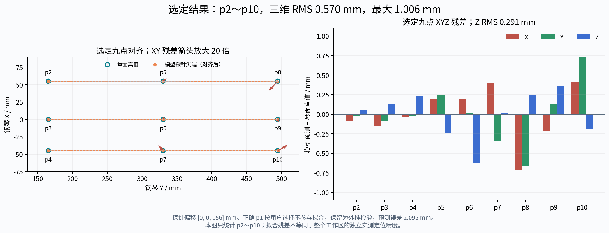
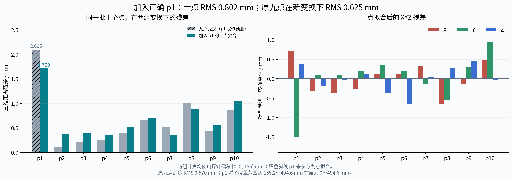

# 右臂刚性探针九点标定分析报告

版本：`right_arm_piano_rigid_probe_20261026_selected_p2_p10`。

**本次交接采用用户选定的 p2～p10 九点解，探针偏移固定为法兰系 `[0,0,156] mm`。** 九点三维拟合 RMS 为 **0.569797 mm**，最大残差 **1.006251 mm（p8）**。正确 p1 保留为未参与拟合的外区检验，三维预测误差为 **2.094625 mm**。

这是比较正确 p1 加入前后结果后作出的工程选型，不表示正确 p1 的截图或真值有误，也不以较低训练 RMS 证明九点解的物理精度更高。当前交付的是结果、分析和离线算例，完整外参尚未自动加载到控制程序。

工程使用入口见 [README.md](README.md)，坐标转换、探针/手指目标到法兰目标的处理及项目接口约定见 [INTEGRATION.md](INTEGRATION.md)。本报告解释数据、几何依据、误差口径和选择的适用范围。

## 1. 数据与求解方法

`P` 表示本次打点使用的用户钢琴系；`B` 表示右臂 MDH 基座系；`F` 表示零工具偏移的法兰系。长度统一为 mm，记录的机械臂关节角为度，顺序为 J1～J7。

每次接触由记录的机械臂反馈角计算法兰位姿，再加入刚性探针的已知偏移：

```text
T_B_from_F_i = FK_arm(q_i)
c_B_i = t_B_from_F_i + R_B_from_F_i @ [0,0,156]
c_B_i ≈ R_B_from_P @ p_P_i + t_B_from_P
```

求解对 p2～p10 等权，允许任意三维旋转和平移，尺度固定为 1，并约束 `det(R)=+1`。九点组成二维非共线布局，可在上述约束下确定刚体外参；共面本身不要求把旋转限制为平面内旋转。

本实验使用刚性探针，接触点重建不经过手指关节链。输入的真值、正确 p1、臂角、MDH 参数、逐点法兰位姿与重建尖端位置均保存在 [calibration_points.json](calibration_points.json)。最终正逆矩阵及 mm/m 版本以 [transform.json](transform.json) 为准。

## 2. 为什么探针偏移是 156 mm

CAD 几何与用户确认的安装方式共同确定法兰到尖端的距离：

| 几何位置 | CAD 局部 Z / mm | 与安装的关系 |
|---|---:|---|
| 探针尖端 | 152 | 实际接触点 |
| 圆盘背面 | −4 | 直接贴合机械臂法兰的基准面 |
| 定位台后端 | −8 | 伸入法兰定位孔，超出贴合面 4 mm |

用户确认探针同轴直接安装，中间没有额外垫片或转接件，定位台进入法兰孔。因此 `152−(−4)=156 mm`，沿法兰 `+Z`，横向偏移为零。零件整体轴向长度 `152−(−8)=160 mm` 包含进入孔内的定位台，不能直接作为当前安装下的法兰到尖端距离。

156 mm 是依据已确认安装几何固定的输入，没有把探针长度作为自由参数来降低最终拟合残差。CAD 关键尺寸、安装确认及源文件 SHA-256 保存在 [transform.json](transform.json) 中。

## 3. 九点真值与拟合残差

钢琴系残差定义为：

```text
e_P_i = xyz(T_P_from_B @ [c_B_i;1]) − p_P_i
error_3D_i = sqrt(e_X_i² + e_Y_i² + e_Z_i²)
RMS_3D = sqrt(mean(error_3D_i²))，仅统计 p2～p10
```

因此正的 `e_Z` 表示重建尖端转换回钢琴系后高于该点真值。三维 RMS 不是把 27 个 XYZ 分量混在一起取均方根；两种口径会相差 `sqrt(3)`。

下表单位均为 mm，显示值保留三位小数；统计使用完整精度。对应数据见 [point_errors.csv](point_errors.csv)。

| 点 | 真值 X | 真值 Y | 真值 Z | e_X | e_Y | e_Z | 三维残差 |
|---|---:|---:|---:|---:|---:|---:|---:|
| p2 | 55 | 165.2 | 22.5 | −0.087 | −0.019 | +0.058 | 0.106 |
| p3 | 0 | 165.2 | 22.5 | −0.147 | −0.082 | +0.130 | 0.212 |
| p4 | −45 | 165.2 | 22.5 | −0.032 | −0.021 | +0.238 | 0.241 |
| p5 | 55 | 330.2 | 22.5 | +0.191 | +0.243 | −0.247 | 0.396 |
| p6 | 0 | 330.2 | 22.5 | +0.192 | +0.016 | −0.626 | 0.655 |
| p7 | −45 | 330.2 | 22.5 | +0.399 | −0.338 | +0.020 | 0.523 |
| p8 | 55 | 494.6 | 22.5 | −0.712 | −0.666 | +0.247 | 1.006 |
| p9 | 0 | 494.6 | 22.5 | −0.214 | +0.136 | +0.367 | 0.446 |
| p10 | −45 | 494.6 | 22.5 | +0.410 | +0.730 | −0.187 | 0.858 |

| 统计指标 | 结果 / mm |
|---|---:|
| 九点三维 RMS | 0.569797 |
| 九点最大三维残差 | 1.006251（p8） |
| 平面内 XY RMS | 0.490011 |
| X / Y / Z 各轴 RMS | 0.330675 / 0.361614 / 0.290790 |
| 九点内部留一预测 RMS | 0.713413 |
| 九点内部留一预测最大误差 | 1.249252（p8） |

内部留一指每次使用八点拟合，再预测该次未参与的第九点，共九次；p1 始终不进入这个计算。它反映同批数据内部的稳定性，不能替代独立的物理定位测量。



## 4. 正确 p1 的外区检验

本包采用用户后来提供的正确 p1 反馈记录：

```text
p1_P = [55,0,22.5] mm
q_p1 = [-48.64,-70.97,34.89,-90.87,+131.72,-45.82,-54.49] deg
e_p1_P = [+1.086653,-1.625706,+0.750812] mm
error_p1_3D = 2.094625 mm
```

其中 J5 为 **+131.72°**。该记录被完整保留，`used_for_fit=false`；它没有参与九点外参和九点 RMS 的计算。旧错误截图的角度不用于本包数值结果。

p2～p10 的钢琴 Y 范围为 `165.2～494.6 mm`，正确 p1 位于 `Y=0`，向外延伸了 165.2 mm。它直接说明当前九点解在这个未覆盖位置的模型闭合偏差约为 2.09 mm，最大单轴分量沿钢琴 Y。

这项检验仍来自本批实验，且已参与工程选型的讨论，不能称为独立采集的盲测。当前残差不能单独区分机械臂名义模型、接触重复性、安装几何和采样同步等因素，也不能据此判定正确 p1 的记录错误。

## 5. 九点与正确十点的公平比较

两种解均固定同一 156 mm 探针、同一机械臂模型和真值，差别仅在是否把正确 p1 纳入拟合。必须在相同评价点集上比较，不能只比较各自训练集的 RMS。

| 评价对象 | 选定九点解 | 正确十点解 |
|---|---:|---:|
| 各自拟合点三维 RMS / mm | 0.569797（9 点） | 0.802046（10 点） |
| 同一组 p2～p10 三维 RMS / mm | 0.569797 | 0.624536 |
| 同一组 p2～p10 最大三维残差 / mm | 1.006251（p8） | 1.055184（p10） |
| 同一组全部十点三维 RMS / mm | 0.854955 | 0.802046 |
| 正确 p1 三维误差 / mm | 2.094625（未参与拟合） | 1.709492（参与拟合） |

加入 p1 后，全部十点的总残差降低，原九点的残差略增，这是等权最小二乘在更大点集上重新分配误差的结果。用户决定以九点解作为本次调臂交接版本；正确十点结果作为对照保留，不能据训练残差宣布其物理精度较差。

十点解相对九点解的旋转变化为 `0.101171°`；钢琴→基座方向的平移参数变化长度为 `0.531935 mm`。在这十个已知真值位置，两套变换预测位置的变化 RMS 为 `0.295931 mm`、最大为 `0.536049 mm`。这些是解之间的差异，不是新的绝对精度指标。

完整同点集统计、留一结果和变换差异保存在 [comparison.json](comparison.json)。



## 6. 与 160 mm 探针假设的差异

同事按 160 mm 分析时，需要首先统一“整体零件长”与“法兰贴合面到尖端距离”的基准。对本次已经确认的安装，后者是 156 mm。为隔离这一参数的影响，保持 p2～p10、反馈角、机械臂 FK 和拟合方法相同，分别改变工具长度并重新拟合：

| 假设的法兰到尖端长度 / mm | 九点三维 RMS / mm | 最大三维残差 / mm |
|---|---:|---:|
| 152 | 1.280599 | 2.081680（p7） |
| **156，安装确认值** | **0.569797** | **1.006251（p8）** |
| 160 | 1.323885 | 2.066462（p10） |

将同一九点的探针长度改为 160 mm 复算，得到基座在钢琴系的位置 `[637.785421,22.075649,324.605647] mm`。与同事 `report.html` 中的基座→钢琴矩阵比较，旋转元素最大差约 `4.77e-10`、平移元素最大差约 `4.34e-7 mm`，与其文本舍入精度一致。九点主结果的差异可由这个 TCP 参考面差别解释。

由 156 改为 160 mm，每次重建尖端会变化 `R_B_from_F_i @ [0,0,4]`。法兰朝向随采样变化时，这些向量方向不同，通常不能被一个统一外参平移完全吸收；因此会同时改变拟合矩阵和残差。

选择 156 mm 的依据仍是安装几何；本表只检验数值一致性。本包使用正确 p1，并且 P5 J6 采用原图当前反馈的 `−35.91°`；同事旧报告中“p1 待核对”和“P5 截图为 +35.91°”的叙述不作为本包的数据依据。

## 7. 适用范围与后续检验

本次拟合点覆盖 `X=−45～55 mm`、`Y=165.2～494.6 mm`、`Z=22.5 mm` 的白键面区域。九点 RMS 为 0.57 mm 表示名义模型和本批数据的闭合程度，不能作为整个工作空间均小于 1 mm 的保证；正确 p1 已给出了约 2.09 mm 的外区偏差证据。

外参适用于相同钢琴原点和轴向、钢琴与右臂基座相对摆放不变的条件。钢琴或基座移动、坐标定义改变、机械臂运动学参数改变时，应重新核对。更换探针或装回手后，基座与钢琴之间的物理关系可以保持，但工具链必须按实际安装更新；该实验没有验证手模型或手指接触精度。

下一步可在 p1 附近及拟合区域内部增加重复触点，并记录同步反馈；使用不参与外参选择的新点和不同法兰朝向检查重复性与泛化。当前结果尚未分别量化尺量真值、探针制造/安装、机械臂模型和接触操作各自贡献的误差。

## 8. 可独立运行的数值复核

将整个交接文件夹复制给同事，在安装 NumPy 的 Python 环境中进入该文件夹运行：

```bash
python verify.py
python example.py
```

[verify.py](verify.py) 从记录的臂角和包内 MDH 参数重新计算法兰与 156 mm 尖端，再重新拟合九点；同时核对输入哈希、正逆矩阵、旋转正交性、单位换算、逐点残差、留一误差及探针补偿闭合。其输出应包含：

```text
Selected nine-point RMS: 0.569797 mm
Selected max residual: 1.006251 mm (p8)
Nine-point leave-one-out RMS: 0.713413 mm
Corrected p1 held-out error: 2.094625 mm
```

脚本按自身目录读取数据，不依赖原仓库或机器人 SDK。[example.py](example.py) 给出点与法兰位姿转换的用法。复核通过证明包内模型、数据和算法一致；硬件接入及实际定位验证仍按 [INTEGRATION.md](INTEGRATION.md) 处理。
