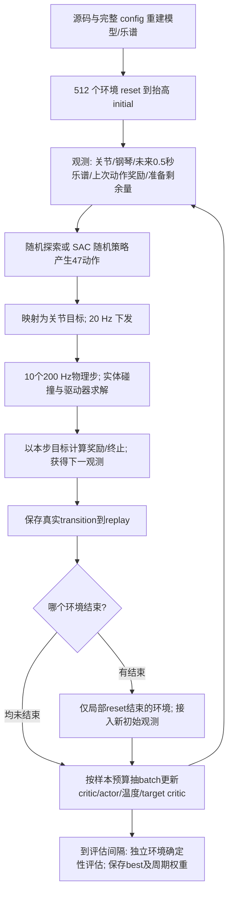

# V3.2：5M 训练审计与效果／速度优化（2026-09-26）

## 目标与验收口径

用户要求音乐 F1 达到 0.99、减少自碰撞、缩短训练时间，先详细分析并调用子任务实现，再直接开启新训练。0.99 是验收目标，不是短测或开训即可作出的结果保证。

- 主要指标：去掉 1 秒准备空谱后的逐帧平均 F1，同时检查音乐段 micro-F1；避免空白帧抬高分数。
- 稳健性：独立完整回合重复评估，保存最差回合的音乐 F1 最高的检查点；达标要求连续 3 次评估、每次 3 回合全部满足。
- 碰撞：统计每个控制周期内所有 200 Hz 物理子步的同手／跨手碰撞，排除正常触键。目标验收要求无手—手碰撞帧，缺诊断或不完整回合不能算通过。
- 准备：保留 initial=origin+2 cm、1 秒支撑回落、策略从第 0 帧训练的既有设置。准备误触单列；20 Hz 无误触不能等同 200 Hz 无短错音。
- 速度：比较相同新采集样本数和评估次数的总耗时、稳态吞吐、更新次数，不把纯仿真速度当作训练速度。

## 已完成训练的事实

父运行：`training_mjlab/outputs/twinkle_policy_preparation_5m-20260926-020140-20260926-020140-983894`。

共 5,000,192 样本、4,995,193 更新、6321.96 秒（105.37 分钟）。日志有 489 次评估。原五项奖励，未启用本次增加的 false-press、自碰撞或 humanoid。

| 检查点 | 音乐 F1 三次复评均值 | 三次范围 |
|---|---:|---:|
| step-8500 | 0.970545 | 0.967450–0.972092 |
| step-9000 | 0.962176 | 三次相同 |
| step-9500 | 0.955907 | 三次相同 |
| final | 0.935127 | 三次相同 |

日志最高 step9560 的音乐 F1=0.974051，但当时没有保存权重（仅每 500 步保存）；不能生成或恢复该未保存模型。选用真实存在且重复表现更好的 step8500 微调，避免从 final 的退化状态起步。

step8500 的完整 200 Hz 诊断发现：1780 子步中 432 子步发生同手碰撞，准备阶段 103、音乐阶段 329；跨手为 0。右拇指 PIP 与食指 DIP 最大穿透约 5.4 mm。20 Hz 准备没有错键，但 0.965–0.980 秒发生短暂提前触键；音乐采样频率提高后的分数也下降。该差异证明端点评分存在盲区，不应归因于视频编码。详细轨迹、错误音符及方法见 `preview/outputs/diagnostics/policy_training_5m_20260926/`。

## 原因与影响

1. **目标不一致**：五项基础奖励并未直接惩罚所有同手接触，掌部 forearm 项也不能代表全部手指碰撞。能弹对并不等于自然、无接触。
2. **评分漏采**：控制端点间 5–45 ms 的短错音可被 20 Hz 指标遗漏，但音频按 200 Hz 触发。此次先完整记录，未偷改既有奖励或目标时间定义。
3. **训练后期退化**：最佳权重和最后权重不同；固定周期保存丢失真正最佳策略。新增逐次评估最佳保存，训练不再只能选择 final。
4. **动作目标阶跃仍在**：step8500 在 1 秒附近 TX 目标变化约 15.55 cm。物理驱动使实际速度有限，但不能把高 F1 当作关节平滑。没有未经验证加入限速、插值或腕部映射。
5. **更新串行开销**：当前每条 transition 一次 SAC 更新，500 万次 learner 更新主导耗时。仅增加并行环境不能消除这部分。

## 整个训练循环的实际顺序



终止 transition 的下一观测先进入 replay，随后仅结束的环境局部 reset，不把 reset 后的初态错接为上一回合终态。新回合再次从抬高 initial 开始，不从上一回合末尾继续；视频整曲回放不会显示训练期间其他世界的 reset。

准备的 20 帧不是策略停机：手指、TX/TY/Pitch 均由策略控制，运动学父支撑沿 Z 回落，20 个真实 transition 与原空谱奖励进入学习。因此“加一秒”能提供学习避错的机会，但不会自动保证手不动或不触键。曲目158帧意味着全回合8.9秒，实际准备加演奏均受物理仿真。

评估使用独立环境和 Actor 均值动作；训练使用随机策略。训练奖励、评估 F1、可听音符、实际接触是不同量，不能相互替代。GPU 接触求解浮点差异会使同权重独立回合轻微分叉，故增加重复评估并取最差回合。

相比旧 Shadow 单环境，当前并行512条 transition 一次采集后集中更新；旧每条采样后更新一次。即使学习率、网络与每样本更新预算相同，采样／更新交错及手的几何、直接关节驱动、惯性也不同。不能把“复制Shadow参数”视作复制整个训练轨迹。本次选择较大batch只减少串行更新开销，效果必须与原预算对照。

## humanoid 会不会鼓励不动

旧工程项对“当前无指法”的每指给最高 0.2，十指上限 2.0；准备期静止可以累计显著额外奖励，且即将弹奏的手指提前移动会失去奖励。虽然当前弹奏指和腕部没有被直接锁定，该目标确实可能与提前抬指、移指竞争。

新模式显式命名 `task_conditioned_v1`，保留旧模式供旧配置回放：

```
r = I(当前有音符且所有目标键正确、无错键)
    × 0.05 / 10 × Σ[当前至未来0.25秒不用的手指] exp(-MSE(q_f, q_origin_f)/(2×0.25²))
```

准备／休止／漏音／错音时为 0；当前和未来 0.25 秒使用的手指不受姿态约束；全手总奖励不超过 0.05。参考姿态继续使用用户已指定的 40 个 reset 实际关节角。它不会因“不弹琴”本身获得该奖励，但仍是改变任务目标的 shaping，不能数学保证最优策略不退化，须做启用／关闭对照。它也不等同于论文 pp.11–12 式20 的自然动作惩罚。

## 详细实施计划与责任

| 阶段 | 工作 | 实现／验收 |
|---|---|---|
| 1 | 全曲线、四个检查点各三次原图复评，200 Hz 碰撞／错音审计 | `startup_motion_audit` 子任务；匹配旧源码归档，严格散列验证 |
| 2 | 有条件的小 humanoid 奖励、未来手指豁免、物理子步碰撞诊断 | `lift_warmup_design` 子任务；旧公式兼容、空谱／漏音反例、局部 reset 与 CUDA graph 验收 |
| 3 | best 保存、最差回合质量门槛、初始评估、严格合同网络微调 | `training_speed_audit` 子任务；不允许跨模型／时序／动作合同静默加载 |
| 4 | 同父、同种子、同新样本预算下对比原 batch256×1 与 batch1024×0.25 | 主任务串行 GPU 短测；只在短测后选用用户授权的加速候选 |
| 5 | 在选定计算预算下对比基础奖励、错键+自碰撞、再加新 humanoid | 主任务；同时看音乐准确率、准备误触、碰撞与吞吐，避免只看总 reward |
| 6 | 固化实际全部参数、源码归档、启动新训练并核验首次更新／评估 | 主任务；新运行记录父权重散列、奖励、学习预算、来源及最佳模型 |

微调采用新优化器／replay，网络来自 step8500。初始 alpha 采用父策略学到的 0.00177785978，保留自动温度学习；不把已学会的低熵策略重新置为 alpha=1。前 91,136 条样本（512 环境各完成 178 帧整曲）仅由父策略采集、不开随机探索，之后才更新，避免新 replay 只有准备帧时开始训练。其余网络、LR、gamma、时序和实体碰撞保持既有合同。

## 用户已决定的 SAC 差异

2026-09-26 用户明确答复“允许短测后采用加速配置”。当前 Shadow：batch256、1 更新／样本、采样复用量256；候选：batch1024、0.25 更新／样本、采样复用量仍256。论文 pp.8–10 表2：batch4096、0.125 更新／样本，复用量512。候选不是论文原配置，也不是逐次更新数学等价变换，会改变优化轨迹；须报告短测实际结果。三个 LR=3e−4、Actor/Critic256×3、gamma0.8 暂保持。

## 验证、选型与新运行

### 同预算短测（实际完成）

所有组同一父step8500、同seed42、512环境、512向量步=262144样本、178步完整曲目填充replay，初始/256/512步各评估3回合。以下F1/micro为最差回合，接触为最坏回合；不能将平均值当成最坏值。

| 组 | 配置 | 新更新数 | 总秒数 | 更新段稳态样本/秒 | 最终音乐F1 | 最终手碰撞帧/178 | 最终碰撞子步/1780 |
|---|---|---:|---:|---:|---:|---:|---:|
| A | 原5项，batch256×1 | 171008 | 208.96 | 972 | .89916 | 74 | 399 |
| B | 原5项，batch1024×.25 | 42752 | 104.87 | 2631 | .92743 | 75 | 377 |
| C | B＋false1＋self.2＋新humanoid | 42752 | 98.09 | 2642 | .90190 | 16 | 51 |
| D | B＋false1＋self.2，无humanoid | 42752 | 98.02 | 2651 | .86890 | 18 | 66 |

A/B总耗时减少49.8%（约1.99倍），更新段吞吐约2.7倍。包括共同填充、初始评估、编译等，因此短测总耗时与长训稳态外推不同。单种子短测不是多种子收敛比较，也不能用C比B快几秒证明奖励能提速。原数据、统计区间和图表见 `preview/outputs/diagnostics/quality_trials_20260926/`。

C相对同预算B的碰撞子步377→51，减少86.5%，同时F1从.9274降到.9019，存在明确取舍；C相对D的最终F1更高、碰撞更少，本轮保留小额新版humanoid。A–D所有最终F1都低于各自初始评估，**没有观察到微调后音乐能力超过父策略**。`best.pt`保留step0不代表新训练提高了效果。四组最终仍各有1个准备错键控制帧，尚未达标。

### 微调退化的检查

A的step0 actor/critic/target critic逐位等于父，学习到的alpha正确恢复为新初值，没有重置成1；物理、乐谱及canonical原奖励一致。更新后在同一批父轨迹状态上动作明显改变、局部Q却偏好新动作，说明策略目标和短时新replay分布适应会影响表现，不能简单宣称“加载错了”或“critic数值爆炸”。

新replay只有整曲91k策略数据，父原缓冲有1M混合历史；fresh Adam也丢失了400多万步累计的矩估计。每次更新tau=.005，原512次/向量步让旧target权重一向量步后仅余约.077，而新128次后约.526；保持batch×更新比并不保持target/Adam节奏。保留父Adam/alpha/RNG的E组已完成，最终最差音乐F1=.853406、手碰撞85帧/463子步，耗时98.74秒；没有优于B。因此不能把fresh Adam当成退化唯一原因，也不能宣称保留Adam必然更稳。当前证据支持新replay分布和策略/局部价值偏好漂移需要继续检查，不证明单一因果。

### 实现与回放验收

- 奖励／碰撞CPU30项；训练选择／迁移CPU26项＋39子测试；源码回放配置与归档CPU26项；短测汇总3项。
- 真实GPU graph下诊断开启／关闭24步：原reward差0，qpos最大差4.66e-10、qvel2.98e-7，coverage每控制步10，局部reset隔离。
- 新scene/task散列与旧父一致；所有新源码散列保留，没有放宽源版本、动作、时序或物理合同。
- 修复新best metadata包含评估运行字段导致旧eval入口误判config不完整的问题：只将明确的3个运行字段加入既有allowlist；未知字段和配置差异仍拒绝。A–D全部8个真实best/final通过配置验收。C final经eval.sh源码+完整config重建并重复3回合，最差音乐F1=.90189893、micro=.91843972、碰撞16帧/51子步，与训练记录吻合，诊断覆盖率1。

### 八度漏音的独立检查

左Thumb C4和Pinky C3间距164.5mm，CPU找到符合原关节/动作限制的静态胶囊触键解：两种目标键状态×4初值，接触残差<1μm，无>0.1μm额外穿透，指尖均距原指法目标10mm以内。initial本身同手接触为0。不能把漏C4归为跨度绝对不可达；实际拇指离目标51–70mm，需学习更早的手型准备与动态转位。静态解不证明三音动态按稳，未改谱或指法。见 `preview/outputs/diagnostics/octave_reachability_20260926/README.md`。

### 新正式训练

严格回放与同奖励恢复检查已通过，采用C组合继续；从C最终权重恢复同奖励learner/Adam/alpha，重建replay并重新完整填充，保留已有新奖励适应状态；这不保证能消除微调退化。计划新增4096向量步=2097152样本、501504次更新，每100步评估3回合、每次音乐F1改善保存best，连续3次满足.99和零手碰撞才提前停止。学习率继续已确认3e-4；更小Actor学习率尚待用户决定，未擅自采用。已于 **2026-09-26 19:45:55（北京时间）** 启动独立后台进程，入口PID **688043**。核验至step300／153,600新样本／15,616新更新，163个包内文件散列一致；初始化评估与C final一致。训练仍在运行，本节是启动快照。后续检查已到step840（430080新样本），新奖励下已保存最佳音乐F1=.920072；仍低于旧父模型约.971，未通过.99/零碰撞验收。

- [完整config.json](../training_mjlab/outputs/twinkle_quality_continue-20260926-194555-20260926-194556-402944/config.json)、[实时指标](../training_mjlab/outputs/twinkle_quality_continue-20260926-194555-20260926-194556-402944/metrics.jsonl)
- [启动记录](../training_mjlab/launches/twinkle_quality_continue-20260926-194555/launch.json)、[终端日志](../training_mjlab/launches/twinkle_quality_continue-20260926-194555/train.log)
- `best.pt`按曲目最差F1选择，不单独保证低碰撞；同时查看其保存的全部碰撞指标。只有summary的`target_reached=true`才通过本轮联合门槛。
- 当前新训练不热改学习率；未采用尚待用户决定的小Actor学习率候选。
- 新源码归档：`training_mjlab/source_versions/quality_optimization_20260926.tar.gz`，SHA-256 `49cb650a2427d721dc98b7fb57bbcfd2aee008f26e6de98dcf5bd1652b233bda`。按源码+完整config重建，临时scene/task退出清理，不持久冻结场景。

复现本次命令（会创建新时间戳运行）：

```bash
bash run_quality.sh --parent training_mjlab/outputs/quality_trials_20260926/C_humanoid_accelerated-20260926-193537-159014/final.pt --resume-learner --variant humanoid --budget accelerated --vector-steps 4096 --eval-interval 100 --eval-episodes 3 --save-interval 500 --target-stop --output-dir training_mjlab/outputs/twinkle_quality_continue
```

本轮是已有技能上的续训，不能把其总时长与旧105分钟从零训练直接作等效速度比较。2倍加速来自同父、同26.2万样本预算A/B对照。

源码只读归档：`training_mjlab/source_versions/before_quality_optimization_20260926.tar.gz`；旧父运行回放归档：`policy_preparation_acceleration_20260926.tar.gz`。旧 run 和检查点不覆写。

## 剩余 TODO

- **V32-QUALITY-01**：长训是否达到反复可验证的音乐 F1/micro-F1≥0.99 且无手—手碰撞；短测不能替代。
- **V32-GESTURE-01**：新 humanoid 的净收益需对照；如果牺牲准确率或增加碰撞，选择关闭。
- **V32-START-01/02**：腕部策略阶跃及 200 Hz 短错音；本轮不以 20 Hz 通过宣称消失。
- **V32-04/06、V32-SAC-03**：原驱动／接触标定与 CPU/GPU 数值边界继续保留。


## 参考与资料性质

- 本地事实：父运行config/summary/metrics、归档旧源码、实际16次回放、CPU碰撞和IK、A–E短测、C最终严格回放。
- 实现：`mjlab_env/{task,scene,self_collision,reward_config,rewards}.py`、`rl_torch/{train,checkpoint,sac}.py`、源码构建和回放脚本。
- [SAC 原文](https://arxiv.org/abs/1812.05905)作为自动温度背景；本次没有替换SAC算法。
- [Ng等奖励塑形论文](https://people.eecs.berkeley.edu/~pabbeel/cs287-fa09/readings/NgHaradaRussell-shaping-ICML1999.pdf)只用于区分有条件辅助奖励与有策略不变性条件的塑形；本工程humanoid不是该定理保证的potential-based项。
- 本地论文页码和用户决定见 `references/biomimetics_2026_610_notes.md`；未知映射仍未代填。
