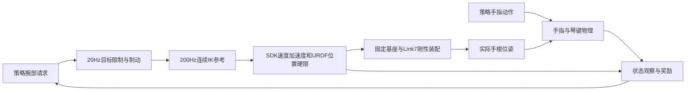

# 当前训练环境与机械臂训练

设计上新训练统一从根目录 `all_use_this_train.sh` 提交并执行固定源码归档；当前工作区缺少该文件，本轮不启动训练。无参数默认无臂；双M6是同一入口的显式选项。环境、源码、实验和预览各有用途，不能把目录名或旧报告中的“当前”当作本轮配置。

## MJLab预览与当前带臂训练完全同步

MJLab预览的同步入口是 `preview/scripts/preview_mjlab.py --training-config`，不是旧的 `preview_pose.py` 或 `preview_arm_ik.py`。配置 [configs/preview/current_arm_training_20261011.json](../configs/preview/current_arm_training_20261011.json) 是按统一入口当前参数生成的可复核预览合同：它记录当前 `source_runtime` 指纹、双侧七角、当前 `controller=rigid_wrist_command` 刚性装配、reward JSON、TX/TY/Pitch目标限幅、手指耦合、准备段和物理图开关。预览先通过 `source_runtime.build` 验证源码与依赖，再构建同一个 `PianoTaskEnv`；任何旧归档或工作区漂移都会明确拒绝。

桌面查看需要图形会话：

```bash
training_mjlab/.venv/bin/python preview/scripts/preview_mjlab.py \
  --training-config configs/preview/current_arm_training_20261011.json
```

不可达位置扫描不打开窗口，使用同一配置和 `SceneBundle + ArmFollower`，默认每侧 `41×9×5×3=5535` 个 TX/TY/Pitch/准备高度目标。固定归档上的推荐命令：

```bash
bash scripts/hpc/submit.sh --gpus 1 --source-archive \
  logs/mjlab_preview_sync_20261011/source_mjlab_preview_sync_v7.tar.gz mjlab-preview \
  --training-config configs/preview/current_arm_training_20261011.json \
  --reachability-audit "$PWD/logs/arm_workspace_audit_20261011/mjlab_preview_scan"
```

扫描输出 `left.csv`、`right.csv`、左右PNG和 `summary.json`。`solved` 是位置误差≤0.1mm、姿态误差≤0.001rad的数值IK见证；`proven_outside_bound` 是超出保守Link7半径上界的必要不可达证明；`unresolved` 不等于无解，仍要做连续路径、SDK双限、碰撞和实际动力学核验。交互窗口中的腕部误差只表示本步请求与FK执行的跟踪差，不能替代扫描分类。

2026-10-10晚间核对：expe00001和expe00002均已取消，未重启正式训练。机械臂刚性装配和目标制动已有控制验收；随后已修复装配引入的父子接触过滤丢失，并通过Slurm2140验收。无臂自碰撞检查保持开启。expe00002原有运动罚饱和、实际腕工作空间及长期学习效果仍需处理。实时状态用Slurm查询，下面的结果是本次审计快照。

## 训练入口与配置来源

| 内容 | 应读取的位置 | 作用 |
| --- | --- | --- |
| 新训练默认与末尾覆盖 | `all_use_this_train.sh` | 唯一维护入口，自动申请双卡，默认无臂 |
| 本轮实际完整配置 | `training_mjlab/outputs/hpc/<本轮目录>/config.json` | 运行配置、实际模型与任务、动作观察合同、初角和基座 |
| 当前奖励解释 | [唯一奖励总表](reward_defaults_20261006.md) | 全部奖励公式、开关、参数、采样及预算；本页不再维护另一份奖励表 |
| Slurm基础设施 | `scripts/hpc/submit.sh`、`job.sbatch` | 分配GPU、核验源码、连接两个环境、记录作业 |
| 已弃用入口 | 旧 `train_coupled_*`、`run_tsensei_a32.sh`、`run.sh` | 已移入 `deprecated/legacy_entries/`，当前不会读取 |

实际调用链：

```text
all_use_this_train.sh 的默认参数 + 用户末尾覆盖
  → submit.sh 申请Slurm双卡
  → job.sbatch 校验并解包固定源码
  → 归档内兼容训练入口 + 上游完整覆盖参数
  → training/.venv 构建模型与乐谱
  → training_mjlab/.venv 执行MJLab与Torch SAC
  → 本轮config.json、metrics.jsonl和checkpoint
```

当前只允许通过根目录 `all_use_this_train.sh` 进入训练；旧入口和旧奖励 JSON 已移入 `deprecated/`，不会作为备用入口。所有 CUDA 训练、推理、验收和渲染仍须经 Slurm。每次开训打印最终完整奖励配置。

## 两个Python环境与辅助目录

| 目录 | 当前用途 | 本次核对 |
| --- | --- | --- |
| `training/.venv` | Composer／dm_control模型构建、CPU分析和原谱处理 | Python3.12.14、MuJoCo3.13.0、dm_control1.0.46；原84包版本保持，追加6个分析／绘图相关包 |
| `training_mjlab/.venv` | Torch SAC、MJLab、MuJoCo Warp | Python3.12.14、Torch2.10.0+cu128、MuJoCo/MJWarp3.11.0、MJLab1.6.0、Warp1.17.0；133包与安装记录一致 |
| `training_mjlab/hpc/cuda-12.8.1` | 用户目录编译工具链 | 由作业加载`cuda_env.sh`，不代替系统驱动 |
| `training_mjlab/hpc/egl-jammy-1.4.0-1` | 用户目录EGL运行库 | 由作业加载`egl_env.sh` |
| `training_mjlab/hpc/environment/` | 安装记录与两个环境的freeze | 可追溯固定requirements；不作为训练输出 |
| `online_control/.venv`、`tactile_benchmark/.venv` | 上位机／轨迹工具、独立触觉benchmark | 独立用途，不能替代主线训练环境或套用其checkpoint接口 |

Composer和learner的MuJoCo版本差异是已有构建／执行分工，不能通过随意合并环境来整理。此次检查没有发现需要整体重装的依赖漂移；learner缺`note_seq`时，已有原谱离线分析使用Composer环境。安装与修复入口为 `scripts/hpc/setup_envs.sh`，详见[环境安装说明](hpc_environment_20260928.md)。

## 固定源码与工作区

当前活动源码归档为 `logs/arm_ccs696_coupling_20261011/source_arm_ccs696_coupling_v5.tar.gz`，SHA以根入口的`training_archive_sha`和归档同目录`.sha256`为准。MJLab预览另使用 `logs/mjlab_preview_sync_20261011/source_mjlab_preview_sync_v7.tar.gz`；它只把预览同步代码和合同加入可复核运行时，不替换训练归档。更早的 `arm_parent_filter_fix` 归档已移入 `deprecated/`，不参与当前流程。

预览专用归档在父子过滤修复和同手惩罚封顶基础上加入MJLab预览同步代码、当前双臂预览合同和`mjlab-preview`作业入口；训练入口仍固定 `self_collision_cap`，训练物理、奖励和无臂自碰撞路径保持。归档差异、CPU小扫描和Slurm验收记录在`logs/mjlab_preview_sync_20261011/`。`arm_parent_filter_fix` 等旧归档仅作为隔离记录，不参与当前训练。

三个层次应分别使用：

- 工作区：今后的编辑位置，当前有大量既有未提交修改，不能当作干净发布版本。
- 统一入口固定归档：未来默认训练执行的代码；算法改动须验证后更新归档及入口SHA。
- `logs/hpc/<JOB_ID>/source.tar.gz`与`source/`：该作业实际冻结代码，配合原config和PT用于回放。

旧归档、实验 JSON、checkpoint 和回放产物已移入 `deprecated/`，当前入口不读取它们，也不承担旧 PT 兼容。新的控制或奖励设计直接从头训练。

## 当前机械臂控制与策略接口

当前活动合同为 `current rigid_wrist_command controller`。策略仍输出腕部目标和手指动作，没有增加14个直接机械臂关节动作。下游连续IK把腕请求转为SDK硬限内的机械臂轨迹，实际手根固定在Link7、法兰和四孔连接件上。

CCS696在线IK同时执行SDK的J6/J7位置耦合：`1.025×|J6|+|J7|≤110.5°`，并保留独立J6±60°、J7±90°位置盒。求解候选先做耦合可行性筛选；下发前沿当前状态到候选轨迹做可行线搜索，因此耦合修正不会突破每个200Hz步的速度、加速度或位置硬限。初始角违反耦合时在GPU申请前拒绝。



腕PD自由度已移除；原腕请求仍保留。过快或不可达时允许请求误差，手根与法兰保持固定装配，不能通过脱离装配或突破硬限追上请求。机械臂是运动学执行：没有臂力矩动力学、臂碰撞、连接件惯性和臂反作用力模拟，因此控制验收不能解释成实机动力学或硬件安全验收。

当前统一配置下，无臂为31动作／1407观察，带臂为31动作／1461观察；新增54维是双侧实际臂q/v、IK参考和位姿误差。旧手部腕观察槽位在带臂模式保留reset常数占位，实际根运动由新臂观察表达。具体安装、限值和奖励语义见[机械臂当前合同](optional_arm_wrist_ik_requirements_20261008.md)。

`config.json`中 `no_arms=true` 表示基础场景先生成无臂手模型，随后可由 `arm_scene` 装入M6。判断本轮有无机械臂应检查 `arm_follow` 和 `arm_follow_contract`，不能只看这个历史字段。

`--arms` 必须显式给双侧J1–J7七角，单位度；无默认初角，缺参在申请GPU前拒绝。已抬高的t=0手根完整位姿、初角和安装变换一次反算固定基座，动作过程中不重算。旧预览seed不作为训练初态，右臂初角也不能通过七轴全部取反猜得。

## 当前机械臂控制

当前只保留一个机械臂控制合同：`controller=rigid_wrist_command`。它包含腕部目标、连续 IK、目标制动、SDK/URDF 硬限和 Link7—法兰—四孔连接件—手的刚性装配。历史逐步 IK 和独立腕 PD 方案已从活动目录移到 [`deprecated/arm_control_experiments`](../deprecated/arm_control_experiments)，不再作为可选配置或训练入口。

当前预设请求验收中，42cm 左移停止后 0.355 秒停稳，48cm 远请求返回后 0.945 秒停稳；SDK 双硬限和固定连接通过。这些是控制测试，不能说明策略已经学会演奏或任意目标都可达。

expe00002在2026-10-10 13:58:38开始，18:58:08取消。实际目录：`training_mjlab/outputs/hpc/expe00002-20261010-135845-564168/`。

| 已保存证据 | 结果与口径 |
| --- | --- |
| 最后训练日志 | step6000，3,072,000样本，744,576更新；约计划预算的30.72% |
| 初始网络评估 | step0、尚未学习，200Hz原谱音乐micro F1三回合合并11.4524% |
| 最后完整评估 | step5500，200Hz原谱音乐micro F1三回合合并及最差均0%；step6000无已写回完整评估 |
| 已保存best | step5000，2,560,000样本；200Hz原谱音乐micro F1三回合合并1.1309%，最差0% |
| 开始学习后的最高合并评估F1 | 不含初始评估，step2000约8.9955%，没有对应保存PT；不能据该分数回放模型 |
| 实际checkpoint | `best.pt`与第500步`forward.pt`；无`final.pt`／正常结束summary |
| best同次视频 | 单回合200Hz原谱音乐micro F1=0%，与训练三回合结果分开 |

best受琴键底面接触资格筛选，并按三回合最差F1选择；文件名不能解释成全历史合并F1最高。完整视频与原谱／实际按键对比在 `preview/outputs/expe00002_best_20261010/`，现有训练分析在 `logs/expe00002_result_analysis_20261010/`。

## 机械臂训练优先处理的问题

1. **已恢复手部原有接触过滤语义。** 旧best回放同手项每控制步−90；CPU初态对照原无臂0对、旧刚性臂12对。原因是手根改挂mocap后weld=0，MuJoCo不再执行原生父子过滤。修复自动比较转换前后模型，为丢失的20对原有父子关系添加物理body排除，不使用奖励忽略名单。用户原初态复查无臂与修复后带臂均0对；Slurm2140的真实200Hz控制周期未再出现这些伪接触。两种模式的非相邻碰撞姿态均检测到5对，10次子步采样累计50对次，原奖励仍扣−37.5；跨手和指键接触保留。合同新增`parent_collision_filter`，旧 PT 不进入当前训练流程。
2. **定位两项运动罚的饱和来源。** 同次回放的手指／腕TCP运动罚与独立臂运动罚均为−5/步。手指和腕旋转分支计算最终下发目标的离散差分；TCP分支及独立臂罚计算限幅前需求。不能把罚满解释成实际机械臂轨迹突破SDK硬限；需分别记录主导通道、原始请求、下发目标及实际状态，再做受控对照。
3. **核对评估与保存策略。** step2000合并F1较高却无PT；当前best资格和最差回合指标、forward固定阶段与无周期存档应在下一次实验前明确。不能通过重命名现有PT补出缺失模型。
4. **处理实际腕工作空间约束。** 原腕动作范围约束请求，臂SDK硬限约束关节，均不自动保证实际FK手根的高度和禁止轴姿态。原回放的CPU分析见`logs/expe00002_result_analysis_20261010/wrist_range.json`；该问题与本次接触过滤修复分开处理。

恒定的大负分本身不足以证明F1下降的因果关系。接触过滤差异已在物理模型转换层修复；CPU回归38项通过，Slurm2140 GPU验收5项通过。奖励公式、开关、权重和子步累计保持原值。统一入口已固定新归档及SHA，尚未启动新训练，不据短测宣称F1或收敛改善。

动作边界统计须按保存的`action_contract`逐通道归一化：部分通道范围为`[0,2]`，统一使用`abs(action)>.95`会把中位动作计成饱和。结果分析已按逐通道上下界修正；动作近边界不等于真实关节硬限超限。上述两项−5罚分来自同次实际奖励记录，口径独立。

## 常用检查与后续训练

在项目根目录只读检查：

```bash
squeue -u "$USER"
sacct -j 2075,2109 --format=JobID,JobName,State,Start,End,Elapsed
sha256sum logs/arm_parent_filter_fix_20261010/source_rigid_arm_parent_filter_v1.tar.gz
```

未来新训练使用当前统一入口及完整配置；带臂必须显式追加 `--arms --arm-initial-left-deg <7角> --arm-initial-right-deg <7角>`。当前 reset 初角唯一记录在 `configs/preview/current_arm_training_20261011.json`，不从历史日志恢复。

原审计证据保存在 `logs/training_environment_audit_20261010/`：环境和队列快照、原固定源码比对、CPU入口检查及手部接触过滤对照。本次修复证据在`logs/arm_parent_filter_fix_20261010/`，包含新归档、原初态对照、CPU／Slurm验收和新入口检查。历史报告中的状态均按当时记录理解；日常从本页、根入口和本轮config进入。
