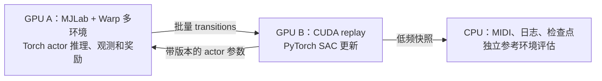

# V3.2 训练方案：MJLab + SAC

> 2026-09-28 工作约定更新：本文保存 2026-09-17 的迁移方案与验收事实。用户已取消强制论文阅读、逐项比对和因论文内容重合而征询对齐决定的要求，后续训练不以论文参数为默认依据。实际训练以 [run.sh](../run.sh)、所选命令参数、完整 `config.json` 和实测结果为准；历史配置及未知模型映射的校验继续保留。

更新：2026-09-17。**当前主线：MJLab Simulation + Torch 任务层 + MuJoCo Warp GPU 物理 + 自定义 PyTorch SAC + GPU replay。** 本文替代原来的直接 MJX-Warp + JAX 主线，保留原文件名以维持已有链接。

状态：已有 `tsensei_v3_2_pianist/rl/` 的 CPU MuJoCo + JAX SAC，以及 MJLab 单 GPU 物理场景和有指法 Torch 音乐任务。物理见 [场景验收说明](mjlab_scene_acceptance.md)，乐谱／观测／奖励／结束／指标见 [任务验收说明](mjlab_task_acceptance.md)。PyTorch SAC、GPU replay、单卡训练／评价／检查点及策略预览已实现，见 [单卡验收](torch_sac_acceptance.md)；双卡入口与正式学习质量仍待完成。

### 2026-09-17 迁移与参数选择记录（历史）

用户提供的 Biomimetics 11, 610 v2 已归档为可选参考，见 [历史论文记录](references/biomimetics_2026_610_notes.md)。2026-09-17 用户确认完整迁移 CPU 规则、不使用错键终止，并提供合适指法，该轮无需验收无指法分支；V32-PAPER-01～08 和11 记录当时的选择。随后用户选择当轮 SAC 采用论文参数，10已实施，09提供参数档位与网络转移，未实施完整奖励课程。这些是历史事实，不构成后续默认参数或审批流程；未披露的 reset／折扣／shaping 细节也不能推测成原作者实现。

## 1. 已确认的基线与 TODO-01

**V32-01：按用户判断，当前仿真安装方案阶段基本完成，作为 MJLab 迁移基线使用。** 已有规范化坐标系、World/wrist 坐标轴、安装位置／关节初值保存，以及“同符号 yaw 同向、pitch 反向”的腕部约定。实际训练采用迁移时冻结的配置文件与模型散列，不能把说明中的历史数值当成最新保存值。

本状态表示当前仿真方案获用户接受；真机安装测量是后续部署的复核事项，不阻塞当前 GPU 仿真迁移。V32-02～07、V32-10 的虚拟腕部、驱动、速度、接触、指尖和正式右手事项仍独立保留。特别是右手仍为临时镜像。

计算资源沿用原两卡预算：用户提供的整机为 8×A100-SXM4-80GB、NVLink/NVSwitch、64 物理核／128 逻辑 CPU、约 2 TiB RAM。实际分配两卡、P2P、MIG、驱动和 CPU/RAM 配额待核验，不默认占用整机。

## 2. 为什么这样组合

MJLab 以 MuJoCo Warp 为 GPU 物理后端，采用可组合的环境管理器；数据接口面向 PyTorch。将观测、动作、奖励、replay 和 SAC 更新统一为 PyTorch CUDA 张量，减少每步跨 NumPy／JAX／Torch 的转换。这是本项目的工程选择，吞吐仍需实测。[官方架构](https://mujocolab.github.io/mjlab/main/source/architecture_overview.html)、[项目说明](https://github.com/mujocolab/mjlab)

MJLab 官方训练集成主要是 RSL-RL 的 on-policy runner／PPO 配置；采用 MJLab 并不会自动得到与当前实现一致的 SAC。因此项目需要自己的 off-policy 采样、回放和训练入口，当前通过 MJLab Simulation 提供物理，项目 Torch 层提供任务；尚未接入 ManagerBasedRLEnv。[官方训练集成](https://mujocolab.github.io/mjlab/main/source/training/rsl_rl.html)

| 层 | 本次决定 | 现状 |
| --- | --- | --- |
| 环境／物理 | MJLab + MuJoCo Warp | 本机1／16／64环境物理与独立reset已验收；有指法Torch任务已通过16／64环境对照 |
| 算法 | PyTorch SAC，当轮参数选择见上述历史记录 | CPU/CUDA各1870项JAX对照通过；16／256环境短训练通过 |
| Replay | 设备内批量环形缓冲区 | CUDA批量写入／采样、环绕／超容量／末帧与所有权验证通过 |
| 正确性参考 | 现有 Composer/dm_env + JAX SAC | 已有源码和短程验证；保留用于回归 |
| 开发顺序 | 单环境 → 小批量 → 单卡 SAC → 双卡 | 不跳过物理／任务／算法对齐 |

不直接沿用 PPO 的 rollout、GAE 或奖励处理。PyTorch SAC 权重结构和优化器状态与现有 JAX checkpoint 不兼容；如需转换，作为单独、可验证的工作。

## 3. 版本与工程边界

2026-09-17 通过官方远端查询和原文件核对的 MJLab 参考提交为 `8ee51fbcf806a7419189f706d9e394cbeb7790fa`。第一阶段已安装并使用该提交；本机验证版本为 MuJoCo/MuJoCo Warp 3.11.0、Warp 1.17.0、PyTorch 2.10.0+cu128，完整锁文件见 `training_mjlab/requirements-tested.txt`。A100 上仍需核验驱动与分配资源，不要让训练随 main 分支漂移。[依赖声明](https://github.com/mujocolab/mjlab/blob/8ee51fbcf806a7419189f706d9e394cbeb7790fa/pyproject.toml)、[安装说明](https://mujocolab.github.io/mjlab/main/source/installation.html)

目录状态如下，场景、任务和单卡SAC均已实现：

```text
tsensei_v3_2_pianist/
  mjlab_env/          # 物理场景、动作/reset、乐谱/观测/奖励/结束/指标
  rl_torch/          # SAC 网络、损失、GPU replay、训练、评估和检查点
scripts/
  export_mjlab_scene.py
  validate_mjlab_env.py
  export_mjlab_task.py
  validate_mjlab_task.py
training_mjlab/       # 已有独立依赖环境、锁文件、冻结场景及验收输出
```

运行时仅依赖本独立项目和安装的第三方库；不导入母仓库、V2/V3 或只作参考附件目录。保留原预览 `.venv` 和 JAX `training/.venv`，新依赖放独立环境；保留已有来源／许可证记录。

## 4. 环境迁移必须保留的行为

### 4.1 场景和动作

- 使用本项目最新左右 URDF、网格和当前手模型构建器离线导出完整 MJCF；手指、小指新语义、掌部排除、钢琴质量／弹簧／阻尼和求解器设置一起冻结。预览 XML 不携带完整 reset 姿态，必须另存 qpos、qvel、ctrl、安装变换及相关键名映射。
- 首版通过 MJLab 的 `Simulation(model=...)` 按整体双手＋钢琴导入，保留原模型引用与选项；音乐规则另由本项目 PianoTaskEnv 提供，未接入 ManagerBasedRLEnv，也未拆分 Entity。后续按需拆 Entity，避免改变附着、碰撞排除和执行器引用关系。MJLab 包装已有位置执行器时需避免再次叠加 PD 控制或重复增加执行器。[执行器说明](https://mujocolab.github.io/mjlab/main/source/actuators.html)
- 保留 51 维动作：右手 25、左手 25、踏板 1；物理执行器 nu=50，nq=nv=138。按名称建立索引，不能依赖模型导入后的数组顺序。
- SAC/replay 使用归一化动作；50 个执行器按各自上下限还原位置目标，踏板映射到 [0,1] 并作为任务状态处理。不得直接套用围绕 default joint position 的相对动作公式。
- 当前左手 pitch 局部 −X，右手 pitch 局部 +X；yaw 两手局部 −Y。从实际模型读取，禁止再次“镜像补偿”而改回旧方向。
- 物理步长 0.0005 s，控制周期 0.05 s，`decimation=100`（硬接触验收后更新）。当前单环境 reset 后的左右初值优先读取 `INITIAL_ANGLES_BY_SIDE`。
- 保留当前训练基线的重力补偿设置并与 CPU 参考一致；预览默认和训练默认不同，必须作为显式配置。

### 4.2 Torch任务与乐谱

| 内容 | 当前实现 | 验收重点 |
| --- | --- | --- |
| 乐谱 | Torch任务状态保存每环境独立的索引、音符、指法和踏板；首版同批同一乐谱长度 | MIDI 仅在 CPU 预处理；前瞻越界掩码与原任务一致 |
| 观测 | 固定字段顺序的 Torch 组装 | 默认有指法1180维，三帧3540；无指法不属本轮范围；由导出合同实测 |
| 历史 | 上一物理动作、上一奖励、可选 frame stack | reset 的填充值和更新次数对齐现有包装器 |
| 奖励 | 按键、踏板、功率、指法距离、掌部碰撞逐项移植 | 固定状态对比各项和总和；功率保持绝对执行器功率，不改为扭矩平方 |
| 终止 | 曲目结束、时间截断分别记录；用户不使用错键终止 | 对照原 `discount`，避免改变 bootstrap |
| Reset | 仅对结束的 env_ids 重置全部物理与任务状态 | 乐谱／踏板／历史／计数器不串环境；不重置仍运行的环境 |

已接通有指法 Toy 与 TwinkleTwinkleRousseau；缺失／非法指法明确报错。用户将提供合适指法，无指法 SciPy 匈牙利指派分支不属本轮实现或验收，也不阻塞后续 SAC。若以后需要，再单独迁移等价计算和边界验收，不替换为最近邻。

### 4.3 三项必须显式处理的差异

1. **奖励时间缩放**：当前 CompositeReward 是每步直接求和；MJLab 默认会乘控制步长。参考提交支持 `scale_rewards_by_dt=False`，当前自定义 Torch 任务层直接求和、不经过该管理器；以后接入时须显式关闭，避免奖励和熵项的相对尺度改变。[奖励实现](https://github.com/mujocolab/mjlab/blob/8ee51fbcf806a7419189f706d9e394cbeb7790fa/src/mjlab/managers/reward_manager.py)
2. **结束帧与 reset**：当前 PianoTaskEnv 显式手动 reset，效果对应 `auto_reset=False`。先将末帧观测复制进 replay，再对结束的 env_ids 调用 reset；下一轮 actor 使用对应的新初始观测。当前返回观测已 clone，不会被下一 step/reset 覆盖。部分 reset 后应合并观测，避免活跃环境的历史被额外推进。[环境源码](https://github.com/mujocolab/mjlab/blob/8ee51fbcf806a7419189f706d9e394cbeb7790fa/src/mjlab/envs/manager_based_rl_env.py)
3. **物理派生量和奖励时序**：上述源码说明其奖励阶段读取的部分位姿量可能滞后一个物理子步。已对照 CPU：控制末尾显式 forward 刷新几何／速度，缓存最后积分子步的执行器力，以保持 Composer legacy_step 的功率时序；这会产生额外开销。不能把该差异混进“纯算法迁移”。

Replay 独立保存 `terminated`、`truncated`、原任务的环境折扣 d_env；SAC target 中仍是 `gamma * d_env`。真实 CPU TimeStep 对照确认曲目结束返回 discount=1；当前时间限制也保留1。错键终止内部设置0但 Composer 提前读取导致实际返回1；用户决定关闭此功能，本轮未修复旧CPU实现。不能一概用 `1-done`。

## 5. 已实现的 PyTorch SAC 合同

用户2026-09-17选择论文参数，完整配置与命令见 [Torch SAC验收](torch_sac_acceptance.md)。Actor256×2；Stage1 actor/critic/alpha学习率3e−4/1e−3/1e−3、gamma=.85；Stage2为1e−4/1e−3/1e−3、gamma=.90。alpha初值.2、tau=.005、batch4096、256环境、1024向量槽、32更新/向量步，目标熵适配51动作为−25.5。Stage1/2随机预热300/0向量步，learning starts1000，预算20000，评价间隔1000。

未披露的critic层数保留256×3；Dropout(.01)→LayerNorm(eps=1e−6)→GELU，保留tanh Gaussian、log_std[-20,2]及稳定log-prob。target双Q取min，actor取mean，更新critic→target Polyak→actor→alpha；alpha损失为alpha乘停止梯度的熵误差。TD仍为gamma×环境discount，未改变本项目末帧语义。

已用实际本地JAX更新函数导出相同权重／batch／外部噪声与mask的对照；CPU和CUDA各1870项通过，含五次连续更新、梯度和Adam状态。正式训练独立生成Torch随机序列，不宣称相同seed等同JAX。CUDA replay、训练／评价／检查点与策略播放已接通；compile、AMP、多卡仍未实现。

Stage2只提供优化参数及网络转移，清空optimizer/replay并重置alpha=.2；任务仍用现有奖励，未实施论文完整课程或未知shaping公式。原 `sac_default_contract.json` 是JAX历史基线，不是新Torch默认合同；新运行的config.json记录实际配置和散列。

## 6. 单卡到双卡的路线与更新预算

先在一张分配的 GPU 上跑通：N=1 → 16 → 64 环境，再测 128／256／512；V3.2 接触和网格开销较大，不承诺某个环境数必然装得下。阶段内分别记录模型编译、首次图捕获、稳定采样、learner 更新与总显存。

定义新增样本数 N=E×H，完整 SAC 更新次数 U，全局 batch B：`rho=U/N`，`R=U*B/N`。当前采用论文参数B=4096，每个向量步U=32；默认E=256时rho=.125、R=512。runner明确记录向量步、transition和update三个计数。

| 档位 | 环境E | B | 每向量步U | rho | R |
| --- | ---: | ---: | ---: | ---: | ---: |
| 当前论文默认 | 256 | 4096 | 32 | .125 | 512 |
| 仅把环境改为64，其他不改 | 64 | 4096 | 32 | .5 | 2048 |
| 64环境保持默认比例的后续候选 | 64 | 4096 | 8 | .125 | 512 |

同样R不代表同样学习轨迹；改变batch或更新次数仍需独立比较。runner不会因修改环境数自动改U，使用inspect-only核对有效配置。此次256环境仅17向量步／64次更新短测，未完成20000向量步训练或正式吞吐基准，不据此宣布A100或双卡收益。

### 双卡首个候选：采样／学习分卡



采样端 H 从 1 开始，有界队列最多先保留 2 批；队列满时背压，计数守恒。传输动作／观测／奖励／环境折扣及必要元数据，不搬整个物理状态。用 CUDA stream/event 确保快照和 replay 读写顺序，记录 actor 版本差与实际滞后时间；实测 P2P 路径，不把 `non_blocking=True` 当作 NVLink 或真实重叠的证明。

单卡已稳定后，比较上述方案与“两卡各自环境/replay、共享同一 SAC 并同步梯度”的对照。若采用 DDP，必须分别对 critic／actor／temperature 做正确同步、统一全局 batch 和更新顺序，并处理 replay 分片采样差异。MJLab 的内置分布式 PPO 入口不能直接当作分布式 SAC。

### 显存与验收指标

FP32 replay 基础估算每条 `4*(2D+A+2)` 字节；百万条 D=1180、A=51 约 **9.652 GB**，D=327 约 **2.828 GB**，另加终止标记、索引和临时 batch。容量先按实测决定，不能将两张 80 GB 当成共享 160 GB。

每卡记录峰值显存、接触／约束容量与溢出、采样 samples/s、updates/s、队列等待及端到端耗时；CUDA 计时边界等待完成。最终按达到同等按键／踏板 F1 的时间选型，至少三个 seed 评估最终候选，不能只看 FPS 或 loss 下降。V32-04／05／06 的暂定参数与碰撞限制必须随实验报告保留。

## 7. 下一步实施顺序与验收

| 阶段 | 具体交付 | 通过条件 |
| --- | --- | --- |
| **P0：本机场景已接通** | 锁定依赖、分配 GPU 信息；冻结当前场景与 CPU 样例；独立场景导出器和 MJLab 单环境加载 | 可 reset／step；51 动作与关节名映射正确；初值、pitch/yaw 方向与当前预览一致 |
| **P1：GPU 物理** | 同场景 1／16／64 环境；单指、和弦、双手、松键和重复 reset 样例 | 无 NaN／容量溢出；接触、琴键激活和短轨迹误差有记录；原网格先测，不擅自删除触键接触 |
| **P2：有指法任务已完成** | Torch 乐谱、动作、观测、分项奖励、终止和手动部分 reset | CPU固定状态数值对照和真实GPU轨迹通过；无重复历史更新、末帧丢失、跨环境污染；用户排除无指法验收 |
| **P3：单卡功能已完成** | Torch 算法对照、GPU replay、自定义训练／评估／检查点 | 数值对照通过；Toy 短训练、评估及恢复流程完整，再进入指定曲目学习 |
| **P4：双卡** | 两种架构的传输／同步、环境数与 B/rho 基准 | 计数与参数一致性、策略滞后和显存达标；有端到端收益 |
| **P5：学习验收** | 确定曲目、训练目标及多 seed 对照 | CPU 参考评估的演奏质量达标；报告真实耗时／差异，未达标继续诊断任务和物理 |

**P0/P1 已在本机 GPU 通过单场景及 16／64 环境、独立 reset、逐子步接触容量和硬止挡验收，见 [第二阶段验收](mjlab_batch_acceptance.md)。P2有指法任务已通过本机16／64环境、三帧历史和Twinkle验收，见 [任务验收](mjlab_task_acceptance.md)；P3已完成Torch SAC、replay和单卡链路验收，见 [单卡验收](torch_sac_acceptance.md)；下一步正式曲目学习和P4双卡基准，A100仍需单独复测。**

检查点首版如仅保存网络／优化器／温度／RNG，要明确为 warm restart；精确续训需补齐 replay、环境／乐谱／历史、所有 RNG 和调度状态。沿用 V32-SAC-02 跟踪，不宣称已有 JAX 的恢复直接支持新框架。

## 8. TODO 状态与验收资料

| 编号 | 当前状态与剩余工作 |
| --- | --- |
| **V32-01** | **仿真阶段基本完成（用户接受）；后续真机复核不阻塞迁移** |
| V32-GPU-01 | 本机已锁版本并完成单 GPU 安装；两张 A100 的分配／互联／CPU-RAM 配额待核验 |
| V32-GPU-02 | 本机 1／16／64 环境、独立 reset、触键止挡与逐子步容量检查通过；A100 复测仍待进行 |
| V32-GPU-03 | P2有指法范围已完成：Torch任务、奖励时序、末帧、部分reset与指标；无指法按用户决定排除 |
| V32-GPU-04 | P3单卡功能完成：JAX数值对照、CUDA replay、16／256环境短训练、评价／检查点／策略播放通过；正式收敛仍属P5 |
| V32-GPU-05 | P4：单卡基准后比较双卡拓扑和 B/rho；待实施 |
| V32-GPU-06 | P5：多 seed 演奏质量与实际加速；待实施 |
| V32-SAC-01 | 框架和论文SAC参数已选择；用户正式曲目与演奏质量目标、长训练／多seed效果仍待落实 |
| V32-SAC-02 | 精确恢复仍待实现；Torch首版仅warm restart，另提供Stage2网络转移 |

V32-02～07／09／10 保留原硬件／接触／许可范围；V32-08 已有独立 SAC 基线，下一阶段按本方案接通 MJLab。当前仿真可先使用已记录的临时参数开展迁移对照，不能把真机资料全部补齐设成 GPU 开发的前置条件。

验收资料应包含：版本锁与源散列、导出场景／初值、CPU 与 GPU 对照记录、实际训练配置、SAC 数值对照、replay/reset 边界结果、显存和时间曲线、模型限制与学习指标。当前项目已有 [JAX SAC 验证](sac_validation.json)、[姿态保存验证](initial_pose_save_validation.json)；它们是原基线参考证据；MJLab 场景证据见 [场景验收记录](mjlab_scene_validation.json)，任务证据见 [任务验收记录](mjlab_task_validation.json)。

单卡算法／回放与运行证据见 [Torch SAC验证汇总](torch_sac_validation.json)，参数采用范围见 [论文决策](references/biomimetics_2026_610_notes.md)。
