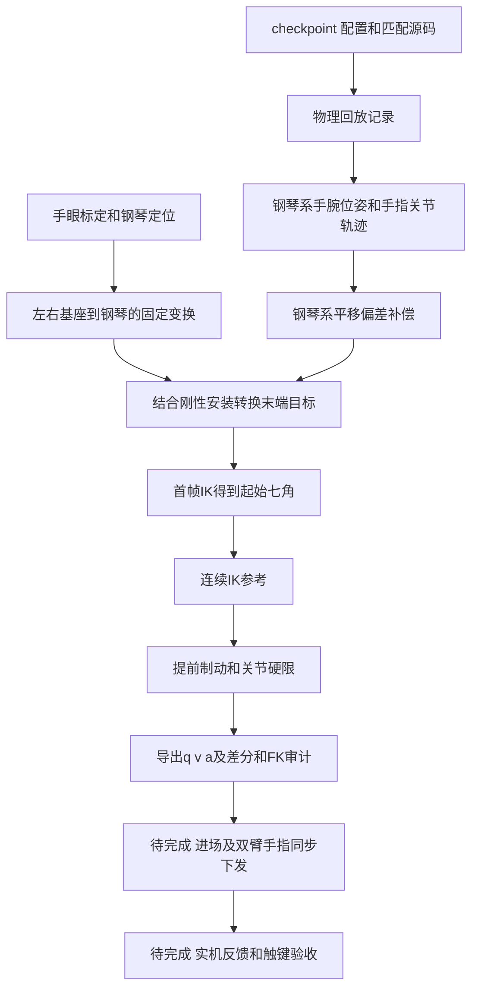

# 强化学习轨迹到钢琴机械臂执行流程

核对日期：2026-10-13。本文面向本项目的轨迹导出与实机接入，列出输入、输出、脚本、命令及完成状态。当前已完成双侧补偿、首帧逆解和离线机械臂目标硬限检查；钢琴定位仍待验收，进场规划、手部执行器映射、双臂联合执行与实机反馈闭环尚未完成。

这里的“已完成”指已有文件与报告，不表示本次重新训练或操作了硬件。最新训练规则以 [AGENTS.md](../AGENTS.md)、统一入口及本轮完整 config 为准；奖励仍只在 [奖励总表](reward_defaults_20261006.md) 维护。

## 流程与状态



| 步骤 | 当前状态 | 已有结果与主要缺项 |
|---|---|---|
| 1 回放与轨迹提取 | 已有本例记录，通用提取入口待补 | 本例来自历史 best19000 的已保存物理轨迹；不能当作最新模型回放 |
| 2 钢琴定位与坐标关系 | 已有数值，标定验收未完成 | 有固定 `T_base_piano`；来源仍 `CALIBRATION_REQUIRED` |
| 3 偏差补偿 | 本例已完成 | 左右分别补偿；固定平移的全程适用性待验证 |
| 4 安装变换与首帧 IK | 本例已完成 | 两侧首帧可行七角；未规划实机到首帧的运动 |
| 5 连续 IK 与硬限 | 本例已完成，左右方法有区别 | 左侧在线连续 IK；右侧保存的连续 IK 参考接限幅器 |
| 6 导出与复核 | 已有离散目标检查报告 | 主轨迹和收停通过；未证明插值后或实机运动满足同样限制 |
| 7 进场与同步下发 | 未完成 | 缺实机映射、进场段、执行调度与反馈记录 |
| 8 演奏闭环验收 | 未完成 | 缺限幅后实际触键、碰撞、负载与实机跟踪验证 |

## 命令使用约定

以下命令默认在项目根目录执行：

```bash
cd /home/hj/pianist
```

- **只读核查**：读取现有产物，可直接使用，不连接设备。
- **参数模板**：必须替换 `/绝对路径/...`；GPU回放与渲染由入口经 `scripts/hpc/submit.sh` 提交 Slurm。
- **条件复现**：现有一次性脚本，无通用 CLI；需先在独立工作副本中调整脚本的 `ROOT/SOURCE/SRC/OUT` 及上下游路径，并核对所有输入SHA。部分脚本遇到已有目录拒绝执行，另一些会覆盖报告、CSV或ZIP。不要删除现有结果来绕过检查，也不要在现有交付目录依次重跑。
- **待实现**：没有经过核对的可执行入口，明确列出缺项，不提供虚构发送命令。

CPU数值脚本使用项目 `training/.venv/bin/python`。本文只新增说明，不把这些一次性脚本改造成自动流水线，也不更新训练归档。条件复现的命令列出实际脚本调用顺序，独立副本中的输出路径仍需逐项对齐。

## 1 从强化学习回放提取轨迹

**输入**：checkpoint、完整 `config.json`、匹配源码归档、场景与原谱；已有同一检查点录制时优先复用。新训练唯一入口为 `all_use_this_train.sh`，提交前按AGENTS预留 exper 编号并配置后台导出回传，本流程不额外发起训练。

**输出**：录制目录中的 `physics_trace.npz`、报告、场景及音频；用于下游的 `trajectory_200Hz.npz`、`both_hand_pose_in_piano_200Hz.csv`、双手关节CSV、来源及SHA。

**脚本**：`export_video.sh` → `scripts/export_videos.py` → Slurm导出。视频必须附同次回放的原始MIDI对比图；补图脚本为 `scripts/plot_recorded_midi_comparison.py`。

参数模板，适用于合同匹配的当前检查点。示例是无臂训练；带臂训练必须保留真实训练机械臂，视图用 `arms`，不能借视频后处理叠加冒充：

```bash
bash export_video.sh \
  --pt /绝对路径/本轮/best.pt \
  --config /绝对路径/本轮/config.json \
  --source-archive /绝对路径/匹配源码.tar.gz \
  --output /绝对路径/尚不存在的导出目录 \
  --video1 noarms front --audio --fingering --finger-labels --dry-run
```

计划核对后去掉 `--dry-run` 才提交；可加 `--recording /绝对路径/匹配录制目录` 复用记录。完成后，如尚无对比图，以同次录制补齐（`midi_comparison/` 必须尚不存在）：

```bash
training/.venv/bin/python scripts/plot_recorded_midi_comparison.py \
  --export /绝对路径/已完成导出目录 \
  --recording /绝对路径/该次物理录制目录 \
  --original-midi /绝对路径/训练对应的原始.mid
```

本例原包来自 **1681实验的 best19000、Slurm1720回放**，无机械臂：1831帧、200Hz、0～9.15秒，前1秒准备段。每手原有23维仿真关节包含TX/TY/Pitch和20个手指关节；首帧原始速度未保存，留空/NaN，不伪造测量值。手根位姿是仿真实际状态，后续才将它用作新的离线目标。见 [原始包说明](../results/left_wrist_compensation_20261013/original/README.md)。

**提取脚本缺口**：`results/left_wrist_compensation_20261013/original/export.py` 是来源快照，使用 `__file__.parents[2]` 推导根目录，并写死旧录制位置。复制后的路径层级不同，还依赖旧模型加载，不能作为当前入口运行。`scripts/export_trajectory_bundle.py` 的用途是校验/渲染已有轨迹包，不是从任意checkpoint生成通用轨迹包。尚需实现当前录制到标准手腕/手指轨迹的参数化提取入口。

现有数据只读核查：

```bash
training/.venv/bin/python - <<'PY'
import numpy as np
p = 'results/left_wrist_compensation_20261013/original/trajectory_200Hz.npz'
with np.load(p, allow_pickle=False) as a:
    t = a['time_s']
    print('frames/start/end:', len(t), t[0], t[-1])
    print('fields:', a.files)
    for side in ('left', 'right'):
        print(side, a[f'T_piano_{side}_hand'].shape, a[f'{side}_joint_names'])
PY
```

## 2 钢琴标定与基座变换

**输入**：左右手眼结果 `T_base_camera`、相机测得钢琴姿态、用户确认的钢琴原点与轴向、关节角/SDK法兰位姿配对样本。

**输出**：每侧固定 `T_base_piano`、`T_link7_sdk_gripper`、采集ID、有效性及来源SHA。本例保存在 `results/{left,right}_flange_ik_20261013/report.json`；首帧报告也保存计算所用矩阵。

本文 `T_A_B` 表示把B坐标转换到A坐标。基本关系为 `T_base_piano = T_base_camera @ T_camera_piano`，还需统一视觉轴向。当前钢琴系 +X朝演奏者、+Y低音到高音、+Z向上；脚本的视觉到用户轴约定为用户X=−视觉Y、用户Y=视觉X、用户Z=视觉Z。

**对应脚本及边界**：

| 脚本 | 实际作用 | 复现依赖 |
|---|---|---|
| `results/right_flange_ik_20261013/calculate.py` | 读取定位/手眼，恢复右基座变换及SDK安装，再解单点法兰目标 | 项目外1010手眼ZIP、定位客户端 `latest.json` |
| `results/left_flange_ik_20261013/calculate.py` | 使用0903左手眼、1010右手眼、保存右侧报告及给定左原点 | 项目外两份ZIP、已保存右侧报告 |

左钢琴原点在左基座下为 `[624.2454697254793,329.3177395197833,-39.968818781060925]mm`，朝向由保存关系恢复。两脚本同时求过法兰 `[200,0,100]mm`，该单点解不是补偿轨迹的起始角。

**命令：只读查看冻结结果**，不重新读取可能变化的 `latest.json`：

```bash
python3 - <<'PY'
from pathlib import Path
import json
for side in ('left', 'right'):
    p = Path(f'results/{side}_flange_ik_20261013/report.json')
    d = json.loads(p.read_text())
    print(side, {k: d.get(k) for k in (
        'capture_id', 'localization_valid', 'reason', 'localization_reason',
        'T_base_piano', 'T_link7_sdk_gripper')})
PY
```

**当前缺项**：仓库没有统一的手眼采集/钢琴定位CLI；外部定位采集命令尚未纳入本流程，不能用上述单点IK脚本冒充标定入口。来源仍 `CALIBRATION_REQUIRED / valid=false`。应固定采集快照、验证相机与基座关系、安装和零位，以及多点实测残差，再将结果晋升为实机已验收标定。

## 3 钢琴坐标系内补偿轨迹偏差

**输入**：原始 `trajectory_bundle.zip`，测得“实际−期望”的钢琴系偏差。两脚本当前均写死输入 `/home/hj/下载/trajectory_bundle.zip`。

**输出**：各侧补偿目录中的 `trajectory_compensated_200Hz.npz`、该侧wrist CSV、双手位姿CSV、`metadata.json`及原件副本。

| 侧 | 实测偏差XYZ mm | 命令补偿XYZ mm | 脚本 |
|---|---|---|---|
| 左 | −10，−9.6，+26.5 | +10，+9.6，−26.5 | `scripts/compensate_left_wrist_20261013.py` |
| 右 | −2，−14，+14 | +2，+14，−14 | `scripts/compensate_right_wrist_20261013.py` |

条件复现命令，两脚本均以 `exist_ok=False` 创建写死的输出目录，现有目录不应覆盖：

```bash
training/.venv/bin/python scripts/compensate_left_wrist_20261013.py
training/.venv/bin/python scripts/compensate_right_wrist_20261013.py
```

处理公式为 `T_piano_wrist_new = D_piano @ T_piano_wrist`，D为钢琴系纯平移。不能右乘成手腕局部补偿。保留完整旋转、时间和两侧手指；已有约0.15rad姿态不重复叠加，准备段也不再次抬升。原23维qpos只保留在 `original/`，不能拿未补偿的TX/TY/Pitch代替补偿后三维手根位姿。

**状态**：两侧单独完成；左包只改左，右包只改右，尚无统一双侧补偿入口。恒定平移、无姿态误差是本例假设，单点测量未验证全路径适用性。详见 [左补偿](../results/left_wrist_compensation_20261013/README.txt)、[右补偿](../results/right_wrist_compensation_20261013/README.txt)。

## 4 安装变换与首帧初始角

**输入**：补偿后首帧完整wrist位姿、固定 `T_base_piano`、`configs/preview/hand_connector_20260930.json`、当前左右M6 URDF、用户当前七角作为选解种子。

**输出**：每侧 `t0_report.json`，含未舍入角度、显示角度、矩阵、FK残差、限位/耦合与来源SHA。左侧另由 `export_flange.py` 输出全程SDK法兰目标CSV/NPZ及首帧角CSV/TXT。

```text
T_base_Link7(t) = T_base_piano @ T_piano_wrist_new(t) @ inverse(T_Link7_wrist)
T_wrist_flange = inverse(T_Link7_wrist) @ T_Link7_SDKflange
T_piano_flange(t) = T_piano_wrist_new(t) @ T_wrist_flange
```

手—四孔连接件—法兰保持完整刚性关系，原点约差29.57mm，不能强行同心；偏移随每帧朝向旋转。自己用URDF链解IK时目标是Link7；调用SDK法兰IK时目标应是SDK法兰，不可混用。

条件复现命令，读取步骤2冻结报告，不执行步骤2的旧单点求解：

```bash
training/.venv/bin/python results/left_wrist_compensation_20261013/derive_t0.py
training/.venv/bin/python results/left_wrist_compensation_20261013/export_flange.py
training/.venv/bin/python results/right_wrist_ik_20261013/calculate_t0.py
```

多起点数值IK后，选择找到的较接近用户种子的可行解，并检查URDF位置限位、完整6D位姿及 `1.025*abs(J6)+abs(J7)<=110.5°`；不保证全局最近或唯一。

| 侧 | 轨迹初始七角 J1至J7，度，仅显示四位小数 |
|---|---|
| 左 | `37.6956, -51.3696, -2.7995, -92.0115, 1.2034, 54.0752, 41.4737` |
| 右 | `-20.2185, -50.1405, -20.1171, -92.2856, 21.6658, 49.0973, -54.6847` |

**种子角不等于轨迹起始角**：种子用于选解；求出的q0用于后续连续轨迹。左侧最终控制器用未舍入解，右侧原连续IK包起点使用上述四位小数；复现按对应文件，不互换。它们也不同于训练配置里的reset七角。

**状态**：两侧首帧已求解并FK检查。尚无实机当前姿态到q0的进场轨迹；不能从实机当前角直接跳到第一帧。离线流程固定测量基座，不能照搬训练 `ArmFollower` 初建时由手姿和初角反算虚拟基座的逻辑；现有导出脚本已显式覆盖为保存的基座关系。

## 5 连续IK参考与运动硬限

**共同输入**：原200Hz时间轴、q0、补偿目标、固定基座/安装、URDF和 `configs/preview/m6_sdk_joint_limits.json`。核心实现为 `tsensei_v3_2_pianist/mjlab_env/arm_follow.py` 的 `ArmFollower`，合同 `rigid_wrist_command`。

**共同输出**：离线限幅后目标q、v、a，IK参考、请求/FK位姿、逐帧误差、合同及源码核对记录。这里的“执行位姿”是目标角度的模型FK，不是实机测量。

### 左侧连续IK及制动

以首帧q0和零速度开始；每步从上一IK参考求新参考，再按当前实际已下发目标的q/v状态提前制动、限制速度和加速度、保证位置与耦合可行。输入是补偿后的记录位姿新请求，没有再次施加训练上游20Hz腕目标投影。

条件复现顺序：

```bash
training/.venv/bin/python results/left_arm_joint_trajectory_20261013/export_controller.py
training/.venv/bin/python results/left_arm_joint_trajectory_20261013/audit_controller.py
training/.venv/bin/python results/left_arm_joint_trajectory_20261013/export_stop_tail.py
training/.venv/bin/python results/left_arm_joint_trajectory_20261013/radians_with_derivatives/export.py
```

依次生成 `controller_raw.npz`/合同 → 主CSV/NPZ/报告/图 → 独立收停CSV → 22列SI单位主轨迹及含收停版本。首脚本拒绝已有 `controller_limited/`，后续脚本会写已有文件；最后一步依赖前面两类输出。

`export_left_arm.py`、`package_trajectory.py` 产生的精确几何IK/重定时文件是诊断对照，不是当前原时序限幅主文件。旧原速几何IK有超速度/加速度，不能因末端误差小而下发。

### 右侧保存的连续IK参考及制动

先用逐帧SLSQP求连续六维位姿IK，目标包含关节连续性和减轻J6/J7负担；以位置限位和四个线性不等式表达耦合约束。再把连续角度作为 `q_ref` 输入当前限幅环节。

条件复现顺序：

```bash
training/.venv/bin/python results/right_hand_arm_trajectory_20261013/export.py
training/.venv/bin/python results/right_hand_arm_trajectory_20261013/finalize.py
training/.venv/bin/python results/right_arm_qva_20261013/export_recorded_reference.py
training/.venv/bin/python results/right_arm_qva_20261013/audit_recorded_reference.py
```

前两步产出连续IK包及manifest/ZIP；后两步读取该ZIP，在 `hard_limited/` 生成限幅主轨迹、收停、q/v/a、原20手指同步列及审计图。重定位输出时需同步调整第3步写死的ZIP输入。

**最终版并未重新运行在线IK**：`RecordedReferenceFollower.solve` 用原包连续七角覆盖参考来源，沿用 `ArmFollower.step/bounds/_stopping_speed/_coupled_segment`。早先 `results/right_arm_qva_20261013/export_controller.py` 的完整在线IK尝试在耦合边界附近停住，其 `controller_limited/` 不是最终交付；`source_conversion/` 也不是限幅主文件。

右侧原IK包的7.5倍慢速参考改变时长和采样率，不能当作200Hz原速轨迹。最终选择的 `hard_limited/` 保持9.15秒原时序，允许跟踪误差。

### 硬限与误差的含义

| 项 | 本例最终目标约束 |
|---|---|
| J1至J7速度 | 180°/s，即π rad/s |
| J1至J2加速度 | 450°/s²，即2.5π rad/s² |
| J3至J7加速度 | 900°/s²，即5π rad/s² |
| 位置 | 当前URDF，按完整精度数值检查 |
| J6/J7耦合 | `1.025*abs(J6)+abs(J7)<=110.5°` |

限幅器会保留到目标和位置边界的制动距离。若可行区间为空、数值无效或硬限复核失败，报错而不推进状态。95%的训练奖励软阈值不等于硬限；运动罚公式及参数仍以奖励总表为准。

**状态**：当前源码相关8个文件与归档的核对记录已在两侧 `source_verification.json` 保存。离线目标硬限不保证实际电机、任意样条插值或TCP物理速度/加速度；也未单独证明手指硬件运动限制。

## 6 导出格式与复核

**输入**：步骤5限幅后的完整精度q、v、a、时间、合同、目标/FK位姿以及收停数据。**输出**：CSV/NPZ、报告、逐帧审计、误差图、来源和SHA清单；对应脚本与顺序见步骤5。

主机械臂CSV为22列：`time_s`，J1至J7位置rad，J1至J7速度rad/s，J1至J7加速度rad/s²。右侧42列合并版再追加20个原手指仿真关节角；这20列尚非厂商执行器映射。

| 产物 | 路径 |
|---|---|
| 左主q/v/a | [left_arm_qva_200Hz_rad.csv](../results/left_arm_joint_trajectory_20261013/radians_with_derivatives/left_arm_qva_200Hz_rad.csv) |
| 左含收停q/v/a | [left_arm_qva_with_stop_rad.csv](../results/left_arm_joint_trajectory_20261013/radians_with_derivatives/left_arm_qva_with_stop_rad.csv) |
| 右主q/v/a | [right_arm_qva_200Hz_rad.csv](../results/right_arm_qva_20261013/hard_limited/right_arm_qva_200Hz_rad.csv) |
| 右含收停q/v/a | [right_arm_qva_with_stop_rad.csv](../results/right_arm_qva_20261013/hard_limited/right_arm_qva_with_stop_rad.csv) |
| 右臂和手指 | [right_arm_qva_and_hand_200Hz_rad.csv](../results/right_arm_qva_20261013/hard_limited/right_arm_qva_and_hand_200Hz_rad.csv) |
| 左报告 | [report.json](../results/left_arm_joint_trajectory_20261013/controller_limited/report.json) |
| 右报告 | [report.json](../results/right_arm_qva_20261013/hard_limited/report.json) |

以实际时间差重新计算 `v[k]=(q[k]-q[k-1])/dt`、`a[k]=(v[k]-v[k-1])/dt`，初始速度按控制器reset为0。禁止先舍入四位小数再做高频加速度检查。

下面是**只读复核命令**，检查两侧主轨迹和含收停轨迹，包含CSV中保存的v/a、位置、速度、加速度和耦合；不运行策略、IK或硬件：

```bash
training/.venv/bin/python - <<'PY'
from pathlib import Path
import json
import numpy as np
root = Path('/home/hj/pianist/results')
for side, folder, contract in (
    ('left', root/'left_arm_joint_trajectory_20261013/radians_with_derivatives',
     root/'left_arm_joint_trajectory_20261013/controller_limited/controller_contract.json'),
    ('right', root/'right_arm_qva_20261013/hard_limited',
     root/'right_arm_qva_20261013/hard_limited/controller_contract.json'),
):
    limits = json.loads(contract.read_text())['options']['joint_limits'][side]
    low, high, vmax, amax = [np.array([r[k] for r in limits])
                           for k in ('min', 'max', 'velocity', 'acceleration')]
    for suffix in ('200Hz_rad', 'with_stop_rad'):
        path = folder/f'{side}_arm_qva_{suffix}.csv'
        data = np.loadtxt(path, delimiter=',', skiprows=1)
        assert data.shape[1] == 22 and np.isfinite(data).all()
        t, q = data[:, 0], data[:, 1:8]
        dt = np.diff(t)
        assert t[0] == 0 and np.all(dt > 0)
        np.testing.assert_allclose(dt, .005, atol=1e-12, rtol=0)
        v = np.vstack([np.zeros((1, 7)), np.diff(q, axis=0)/dt[:, None]])
        a = np.vstack([np.zeros((1, 7)), np.diff(v, axis=0)/dt[:, None]])
        np.testing.assert_allclose(v, data[:, 8:15], atol=1e-9, rtol=0)
        np.testing.assert_allclose(a, data[:, 15:22], atol=1e-6, rtol=0)
        assert np.all(q >= low-1e-12) and np.all(q <= high+1e-12)
        assert np.max(abs(v)/vmax) <= 1+1e-8
        assert np.max(abs(a)/amax) <= 1+1e-8
        assert np.max(1.025*abs(q[:, 5])+abs(q[:, 6])) <= np.deg2rad(110.5)+1e-10
        if suffix == 'with_stop_rad':
            assert np.max(abs(v[-1])) < 1e-9 and np.max(abs(a[-1])) < 1e-6
        print('PASS', path.name, 'frames=', len(t), 'end_s=', t[-1])
PY
```

现有报告结果：

| 项 | 左侧 | 右侧 |
|---|---|---|
| 主轨迹 | 1831帧，9.15秒 | 1831帧，9.15秒 |
| 位置/速度/加速度/耦合 | 全部通过离散目标检查 | 全部通过离散目标检查 |
| 最大wrist位置误差 | 36.132718mm | 5.032020mm |
| 最大wrist朝向误差 | 14.165621° | 2.295472° |
| 可选收停 | 25ms，至9.175秒 | 20ms，至9.17秒 |

主轨迹末帧仍有速度，不可瞬时冻结。收停首行重复主轨迹末行，合并文件已去重。两侧收停长度不同，双臂总调度和手指收尾仍须明确定义，不能擅自补零或拉伸原谱时序。

现有脚本并非完整打包器：右侧 `audit_recorded_reference.py` 生成审计产物但未自动完成最终交付ZIP/manifest；左侧SI转换脚本仅打包该SI子目录。重新复现后仍须完整生成对应来源/散列清单并核验，不能将已有ZIP或报告当作新生成文件的验收凭证。

## 7 实机进场和轨迹下发

**输入**：通过检查的最终目标、实机反馈角度/速度、设备型号与零位/单位/方向映射、已验收基座与工具标定、明确控制器模式/发送周期/插值方式，以及手指执行器映射。

**预期输出**：当前姿态到q0的进场轨迹、同步执行记录、发送与反馈时间戳、实际关节状态及异常/停止记录。此处没有已交付的实机输出。

**对应代码**：`online_control/trajectory.py` 提供导入、统一时间轴采样、组合与验证；`online_control/export.py` 提供离线导出。模块明确不导入设备驱动、不发送命令，不能把CSV导出视为硬件执行。

**执行命令：待实现。** 当前没有核对完成的设备发送CLI。新增执行入口至少需要：

1. 实机当前姿态到q0的连续进场段及到位判断；此时再进入零初速度的演奏轨迹。
2. 验证机械臂七轴的SDK/URDF零位和符号、单位及硬限；验证20个仿真手指关节到厂商执行器的映射和限制。
3. 统一双臂与双手时钟，明确实际控制周期及设备插值，重新验证控制器实际将执行的曲线。
4. 接入反馈与异常停止，明确末端收停及手指保持/释放策略，保留命令和反馈来源。

已有通用验证函数在 `hardware=True` 时会拒绝非 `control_target`、未确认映射或缺限制的轨迹，但它不检查完整空间碰撞，也不能替代上述执行集成。不要只修改语义标签为 `control_target` 就宣称实机可执行。

## 8 还缺的验收与后续工作

**输入**：限幅后轨迹、匹配模型/场景与原谱；实机阶段还需命令、关节反馈和实际触键记录。**预期输出**：同次回放/执行的误差、碰撞与按键时序报告；如导出视频，同次实际按键与原始MIDI对比PNG和事件数据必须一起交付。

**脚本与命令**：步骤1现有视频/绘图入口可服务匹配的物理回放；目前没有将本例补偿后双臂限幅目标直接接入完整物理与实机验收的一体化入口，执行命令待实现。不能把原best19000的F1、声音或触键图作为限幅后轨迹的演奏成绩。

| 待完成项 | 完成条件 |
|---|---|
| 当前录制标准提取CLI | 显式输入录制/config/模型来源，输出两侧位姿和手指轨迹，保存SHA，不依赖旧脚本目录层级 |
| 标定及补偿闭环 | 固定采集快照，核验左右基座/相机/工具，多点测量证实或修订平移假设 |
| 通用离线流水线 | 参数化输入输出、双侧补偿、首帧与全程IK、限幅、审计、统一manifest与恢复流程 |
| 跟踪误差与弹奏验证 | 处理左侧最大36.13mm误差，检查限幅后真实按键时序，不以硬限通过代替弹奏验收 |
| 双臂空间可行性 | 验证完整装配、双臂/双手/琴体路径碰撞，进场与收停也纳入 |
| 硬件执行与反馈 | 完成零位、手指映射、控制模式/插值、同步调度及反馈日志 |
| 实机演奏验收 | 记录实际触键与关节跟踪、负载和停止行为，建立与原谱同轴对比 |

## 依据文件

- [左侧补偿与首帧说明](../results/left_wrist_compensation_20261013/README.txt)、[右侧首帧说明](../results/right_wrist_ik_20261013/README.txt)。
- [左侧最终控制器说明](../results/left_arm_joint_trajectory_20261013/controller_limited/README.txt)、[右侧最终硬限说明](../results/right_arm_qva_20261013/hard_limited/README.txt)。
- [当前机械臂合同](optional_arm_wrist_ik_requirements_20261008.md)、[ArmFollower实现](../tsensei_v3_2_pianist/mjlab_env/arm_follow.py)、[离线轨迹校验](../online_control/trajectory.py)。
- 以上步骤列出的实际脚本、两侧 `t0_report.json`、`controller_contract.json`、`report.json` 和 `source_verification.json`。
