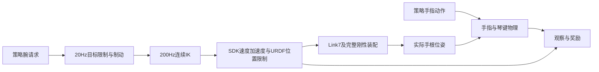

# 当前环境与配置来源

当前工作区仅维护一套机械臂实现：`controller=rigid_wrist_command`。活动配置为 [current_arm_training_20261011.json](../configs/preview/current_arm_training_20261011.json)，奖励配置为 [default_20261006.json](../configs/rewards/default_20261006.json)。旧实验和说明集中在 [deprecated/](../deprecated/README.md)，不作为默认值来源。

## 构建流程

`source_runtime.build` 核对活动配置的源码指纹和依赖版本，经 `training/.venv` 的 Composer 构建 A3.2 双手、钢琴及乐谱。MJLab 使用生成的场景和任务，通过 `PianoTaskEnv` 应用动作映射、结构性移除的腕轴、控制限制、手指耦合、奖励和准备段；训练执行环境为 `training_mjlab/.venv`。两环境承担不同工作，不应随意合并。

有臂时，`arm_scene` 移除腕 PD，把手根刚性连接到 M6 的 Link7、法兰和四孔连接件。当前七角与完整安装变换、初始手根位姿一次反算固定基座，基座不随动作重算。reset 回到这组角度并清理相应环境的目标和速度历史。

IK同时执行 CCS696 的 `1.025×|J6|+|J7|≤110.5°` 约束。过快或不可达时允许腕请求与实际 FK 位姿有误差；不允许装配脱离或突破硬限掩盖误差。新增臂观察包含双侧 q/v、IK 参考与位姿误差；策略没有增加直接控制14个臂关节的动作。

机械臂采用运动学执行，没有臂力矩动力学、臂碰撞、连接件惯性和反作用力模拟。目标差分硬限不能解释为手指真实 qvel/qacc 保证；控制测试也不能替代实机动力学验收。

## 当前初始角

双侧 J1–J7、单位度，活动配置是唯一来源：

| 侧 | J1 | J2 | J3 | J4 | J5 | J6 | J7 |
|---|---:|---:|---:|---:|---:|---:|---:|
| 右 | −84.27055 | −68.29417 | 61.39675 | −89.05803 | −64.834334 | 27.92905 | −7.30834 |
| 左 | 84.27055 | −68.29417 | −61.39675 | −89.05803 | 64.834334 | 27.92905 | −7.30834 |

`--arms` 仍须显式提供 `--arm-initial-right-deg` 与 `--arm-initial-left-deg` 各七角；缺参、越界和耦合不合法在 GPU 申请前拒绝。右手仍是左手镜像推导模型，硬件安装和编码器零位仍须标定。

## 当前与弃用内容

机械臂不再有 schema1/2/3 选择。humanoid 奖励只维护闲指目标 L1 公式，`coefficient=-0.1`、`reference=scene_reset`、`lookahead_steps=20`；同手碰撞只有封顶的 `substep_sum` 累计算法。参数详见 [唯一奖励总表](reward_defaults_20261006.md)。

扫描仍发现其他功能拥有多个可选实现：准备段固定/策略控制、手指固定耦合角/角度范围、几何控制的主动指许可、基础按键/指法公式和独立驱动/碰撞配置。这些不是机械臂 schema 或 humanoid 的历史版本；本轮保留其独立功能边界，不把关闭某功能等同于弃用其实现。以后替换具体算法时直接删除被替代实现，不再增加递增模式。

活动配置包含 `source_runtime.schema`、控制限幅/耦合等合同格式字段。格式字段与可切换算法是不同概念，不能把所有剩余 schema 都宣称为已删除。

## 训练入口与验证边界

设计上唯一训练入口仍为根目录 `all_use_this_train.sh`，所有 GPU 训练、推理、验收和渲染均经 `scripts/hpc/submit.sh` 进入 Slurm。当前工作区没有该根入口及固定训练归档；旧 `train_coupled_*` 和 `run.sh` 已移入 `deprecated/legacy_entries/`。本轮仅更新活动源码、配置与文档，没有提交训练、迁移旧 checkpoint 或宣称训练归档已生效。

每次开始训练必须打印最终完整奖励配置。算法修改通过验收后，需要形成当前源码归档并同步入口校验值；源码和依赖指纹用于保证本轮环境一致，不为已弃用方案提供兼容转换。
