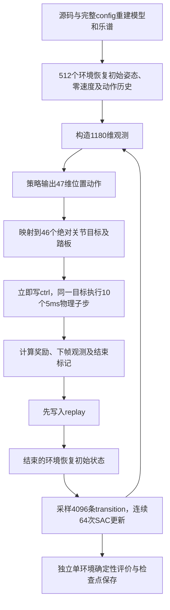

# 训练链路与爆冲／抖动诊断（2026-09-25）

## 范围与结论边界

用户指认的旧基线是 `eval_daxian_unlock／Shadow`。本次找到两个实际结果目录：`/home/houjue/DaxianPianist/results/eval_daxian_unlock_pip_dip`（args标记robot=daxian）以及 `eval_shadow_twinkle_native_20260911_174929`（robot=shadow）。它们是不同手、不同训练，不能混为一个模型。本仓库更早的V3.2 CPU/JAX运行不是用户此次指定的主要基线。

当前诊断对象是 `training_mjlab/outputs/sac-twinkle-source-5m-20260924-1837/final.pt` 及其完整有声回放。当前按键F1较高不等于动作平滑；F1评价琴键激活，对无错音的快速甩腕不直接扣分。

**本次定位到两类不同机理：部分腕部爆冲由大幅位置命令跳变触发；部分手指抖动则是实实在在的碰撞阻滞、反弹。** 相同V3.2模型和控制在CPU上也会出现，不能归因于512环境或GPU本身。用户随后指出“像撞到后弹回”，补充的接触力与同状态单步对照证实了这一观察，纠正了初期只看命令／终点位置时对手指峰值的归因。

本次只进行源码审计、短时动力学对照和记录，没有修改训练算法、模型、奖励或旧检查点。

## 接触追查：确有撞击反弹和瞬时受阻

以下力／力矩来自同模型同ctrl的**CPU重播积分过程**，不是从截图推算，也不是原GPU接触力。每个事件均从相同CPU积分前qpos/qvel/ctrl与warmstart分支，只在模型副本去掉一类接触，推进同一个5ms；保留全部接触的分支与原CPU结果位置／速度误差为0。临时禁碰撞仅用于判因，没有写入训练配置。

### A. 0.700～0.705秒：双手拇指相撞，左拇指被反向弹开

- 左拇指第二旋转关节初始角0.50644rad、目标1.48745rad，执行器仍以**+0.6N·m**朝目标推。
- 跨手接触使该坐标总约束力矩为**−2.64885N·m**，速度在5ms后变为**−21.0869rad/s**；相撞单接触法向力约26.19N。
- 从完全相同起始状态，仅去掉跨手接触，同一步速度变为**+6.27349rad/s**，不再反向弹开。去掉同手或手—键接触不改变该反弹。
- 这直接支持用户描述。0.705秒终点几何已经分开，静态查询看不到接触，**不能因此认定前一个积分子步没有撞击**。之前仅依据终点“无接触”的推断已撤回。

### B. 1.645～1.650秒：左小指被琴键侧面夹挤

小指PIP侧撞黑键28，单接触法向力约**73.52N**；DIP同时接触白键29侧面（约48.50N）和白键27上方（约32.54N）。这是多个接触点，不能将单点力直接等同腕执行器力。

SW目标−0.279908rad仍合法，实际角被挤到−0.435922rad，超出名义下限−0.35约**4.92°**；执行器+0.14363N·m试图拉回，总约束力矩却为−0.25360N·m。同状态分支中，保留接触速度−2.47694rad/s，只移除手—键接触后为−0.04485rad/s。说明此次侧摆主要受琴键接触驱动，而非控制范围检查失效。

### C. 2.465～2.470秒：左食指瞬时顶住，确有“驱动了却没动”

左食指MCP执行器力矩+0.33778N·m，约束力矩−0.34144N·m相互抵消，速度仅−0.03918rad/s；同状态仅移除手—键接触后为+3.51730rad/s。这是瞬时受阻证据。按误差>0.15rad、速度<0.05rad/s连续0.1秒的阈值，全曲没有持续卡死段；不能把短暂顶住说成长时间锁死。

### D. 腕部部分“弹回”仍来自命令反向

0.65、0.80、5.00、5.05秒左TX快速换向时，该坐标约束力为0，命令阶跃驱动反转。5.20秒则混合发生：执行器+30.664N与接触约束+18.873N同向叠加；同状态去手—键接触仍会向正方向运动，只是速度由+0.53233降到+0.31398m/s。

因此修复必须同时处理**控制目标快速变动**与**拇指／琴键侧面撞击**，单修reset、显示刷新或一项SAC参数不能解释全部现象。

[接触与反弹曲线](../preview/outputs/diagnostics/contact_20260925/contact_rebound_evidence.png) · [关键事件](../preview/outputs/diagnostics/contact_20260925/key_events.json) · [同起始状态单步分支](../preview/outputs/diagnostics/contact_20260925/local_forks.json) · [完整接触报告](../preview/outputs/diagnostics/contact_20260925/report.json)。

仅静态几何查询的另一路证据：保存GPU轨迹的跨手凸包最大重叠8.018mm@0.740秒（右拇指rotaback与左拇指MCP），手—键5.638mm@5.050秒（左拇指MCP与白键44）。这不是动态力测量，也不是上述最大力与最大速度的同一时刻。详见[几何与软限位扫描](../preview/outputs/diagnostics/motion_20260925/contact_geometry_limits_20260925.json)。

## 实测证据：命令跳变先发生，物理运动随后追赶

保存动作开环重播，逐5ms记录实际位置、速度、ctrl和执行器力。分别用相同编译模型在GPU与CPU运行，不重新让两套策略各自选动作，以便分离控制命令和求解器差异。

| 测量 | 结果 |
| --- | --- |
| 第一步左腕TX目标 | 0 → +152.859mm |
| 第一个50ms左腕实际位移 | +57.747mm |
| 腕平移速度峰值，发生在25ms | GPU 1.296903849m/s；CPU 1.296903839m/s |
| 第一步右食指DIP目标偏差 | +1.353908rad（77.58°）；实际50ms走31.63° |
| 曲中腕目标最大跳变 | t=5.20s左TX单步+169.240mm，发生在同一回合内部 |
| 手指目标最大跳变 | t=0.60s右拇指rota_block单步−1.916626rad（109.82°） |
| 实际手指速度峰值 | t=0.705s，GPU 21.086853rad/s；CPU 21.086905rad/s |
| 中立目标固定2秒 | GPU最大腕速度约2.53e−7m/s，几乎静止 |
| 首目标固定2秒，统计后1秒 | 最大腕速度约0.000030m/s、手指约0.000117rad/s，强烈运动消失 |

t=5.20s大跳变后将该目标固定2秒，后1秒腕最大速度约0.00461m/s，手指约0.274rad/s、最大峰峰值0.03568rad（2.04°）。说明停止更新目标后运动显著下降，但这组接触姿态仍有小幅调整，不能说所有关节绝对静止。

开环GPU重播与原录像全曲qpos最大差异：腕平移0.160mm、手指0.01014rad；CPU与原录像为0.249mm、0.01337rad。首50ms CPU/GPU腕差异仅约6.13e−9m。长时接触分岔存在，以上不是逐位同轨迹证明；但爆冲量级与峰值几乎一致，足以排除“只有GPU并行才会这样”的归因。

[双手TX/TY全轨迹](../preview/outputs/diagnostics/motion_20260925/wrist_motion.png)

原始数据与复验：[report.json](../preview/outputs/diagnostics/motion_20260925/report.json)、[逐子步数据](../preview/outputs/diagnostics/motion_20260925/substeps.npz)、[诊断脚本](../preview/outputs/diagnostics/motion_20260925/diagnose_motion.py)、[模型参数](../preview/outputs/diagnostics/motion_20260925/model_parameters.json)。在独立项目根目录使用 `training_mjlab/.venv/bin/python preview/outputs/diagnostics/motion_20260925/diagnose_motion.py` 可复验该指定运行，会覆盖本诊断目录同名产物，不改训练目录。

## 1. 当前训练每一步发生什么

- 初始化：手根0.10m、TY0.04m、Yaw0.15rad；TZ/Yaw从物理模型移除，保留相应固定观测槽；无机械臂，重力补偿开启。
- 观测：当前与未来0.5秒琴谱、当前指法使用标记、双手关节位置、琴键与踏板状态、上次动作与奖励；frame_stack=1，**没有关节速度观测**。
- 探索：前150向量步在动作范围内均匀采样，此后使用SAC随机策略；第500向量步开始学习。训练的随机动作与视频的确定性动作不同。
- 控制：20Hz位置目标，200Hz物理，不是速度命令或增量命令。四指MCP输出[0,2]对应[0,1.2]rad；TX目标全跨度1.221m、TY跨度0.15m、Pitch跨度0.4rad。范围限制约束“去哪里”，没有约束“这一帧能移动多少”。
- 奖励：按键、踏板、能量、指法、跨手碰撞、同手碰撞；速度／加速度／超速等可选奖励未开启，false_press_penalty也未开启。能量项读控制周期末功率，不是整段轨迹能耗积分，不能保证中间没有速度峰值。
- 更新：每次新增512条样本，学习后做64次更新，每次batch4096；稳态更新/样本=0.125、样本抽取次数/新增样本=512。不能将64直接称为比旧版“64倍激进”。
- 曲目结束：178步一回合，先存结束transition，再重置；曲末discount=1，延续已确认CPU规则。环境恢复源配置初姿态，不恢复到上一曲末姿态，也不是每个乐句reset。
- 视频：固定网络、单环境、`deterministic=True`，曲末只停留1秒后退出；CPU数据只用于渲染，不再推进另一遍物理。

## 2. 已排查的解释

| 猜测 | 本次证据与结论 |
| --- | --- |
| reset把结束帧覆盖了 | 先入replay后局部reset；观测返回clone，replay有独立存储。当前reset历史已是中立真实目标。未发现该问题仍存在 |
| 视频中途突然重置 | 最新视频单回合中途不reset；不能解释曲中爆冲 |
| 视频随机探索造成抽搐 | 回放为确定性策略，无探索噪声；训练探索会影响学得的策略，但不是此视频当时注入的噪声 |
| 并行环境互相带动 | 每个world有自己的物理和动作状态，未发现索引串线证据。同步reset会使采样相关，但不是单回合瞬移 |
| CUDA外层图造成跳跃 | 有声回放安装逐子步回调，绕过外层10子步control_graph；仍保留内部sim.step图，不能据此排除所有GPU差异 |
| 旧版有插值所以平和 | 旧基线也是绝对位置目标保持，无普遍自动插值／限速；无插值是共同风险，不是新旧差异的唯一解释 |
| GPU更快所以仿真运动更快 | GPU改变计算用时，不改变每步定义的50ms模拟时间；应比较同一模型与控制序列，不按墙钟吞吐归因 |

局部reset、终止观测所有权、replay和SAC逻辑相关的12项已有测试通过。它们不覆盖所有接触姿态，不能替代物理稳定性验收。

## 3. 旧手为何可能明显更平和

### 3.1 不是单环境自带平滑，而是模型与控制响应不同

旧Daxian当前源码 `models/hands/daxian_hand.py::_add_forearm_inertia` 已专门记录“轻CAD手在位置伺服下快速冲向琴键”的问题，并加入0.5kg虚拟腕座、1e-3 kg·m²惯量；平移执行器限20N，按等效质量计算临界阻尼。Shadow模型前臂自身3kg，单手合计约3.794kg，TX/TY阻尼约67.476。

V3.2单手CAD质量约0.171363kg，未加入上述腕座；TX/TY的Kp=300、damping=30、力限50N。**这不是把同一只手换到GPU。** 模型对同样位置误差的速度与接触响应会不同。

不能因为30小于67就认定V3.2“阻尼不足”：以单自由度近似计算，V3.2的临界阻尼约14.34，现值30反而约为其2.09倍。快速跟随大目标阶跃、接触振荡和欠阻尼是不同现象；必须测实际目标、位置和速度才能区分。

旧Daxian的args没有完整历史源码哈希；上述质量／驱动数字来自保留下来的旧项目当前源码，尚未证明每一项就是该历史检查点训练当日参数。Shadow质量／阻尼另有9月24日实例化有效配置记录佐证。

### 3.2 可动关节与碰撞几何不同

Shadow原生结果记录39动作，使用reduced action space与primitive fingertip collisions；当前V3.2为47动作、更多独立手指控制、真实CAD凸包接触。旧Daxian unlock也不能按Shadow的39维理解，其拇指限制、腕轴及PIP/DIP设置另有合同。

本次另实例化native Shadow并核对编译后的实体碰撞：四指近端／中段／末端均为胶囊，根部为圆柱；拇指为球／胶囊；掌部由8个长方体组成，腕为圆柱／长方体；不是拿完整外观网格直接给每节手指做碰撞。四指PIP与DIP由一条腱的总长度（两角之和）驱动，**不是强制两个角相等**。当前V3.2则40个指关节独立追各自位置目标，目标与接触不相容时会持续施力。

MuJoCo的mesh碰撞使用凸包，外观模型凹槽可能被碰撞包络填平；因此复杂CAD外观相近不保证接触行为相近。[官方mesh说明](https://mujoco.readthedocs.io/en/stable/XMLreference.html#asset-mesh)。但本次发现侧面碰撞还不能单独证明凸包错误：即使几何正确，错误运动路径也会撞键；须针对已定位的部件检查碰撞包络与实际可达路径。

两套手的有效collision均未整体屏蔽同手／跨手反力。Shadow每手两对结构exclude加默认父子过滤，V3.2每手一对装配exclude；名单依形态定义，不能逐名字照抄。钢琴参数、20/200Hz、Euler、impratio10和手／琴键solref、solimp已基本同步；本次不能解释为“漏同步Shadow钢琴接触参数”。

旧Daxian unlock为41动作，拇指MCP/PIP固定；其分段映射将四指MCP和解锁PIP/DIP的rest设为下限，策略负半区可映射为伸直0，正半区才屈曲。当前direct_joint_v1没有这个负半区平台：潜变量mean=0时MCP策略输出1、物理目标0.6rad。Shadow的TY范围为[0,0.06]m，当前V3.2为[0,0.15]m，旧Shadow同一归一化变化对应的TY目标变化更小（轴语义仍以各模型为准）。因此即使网络层数相同，初始控制分布和可学到的动作方式也不相同。证据是旧 `wrappers/policy_joint_map.py:81–131` 与 `train.py:602–609`，历史源码一致性边界同上。

简单指尖几何和手指耦合会减少接触切换及策略需要独立协调的自由度；V3.2更容易出现互相挤压或边缘接触。当前接触参数虽参考Shadow，却没有因此变成Shadow的质量、几何与传动。

### 3.2.1 独立Shadow阶跃响应旁证

对native Shadow左手TX给相同+152.859mm阶跃目标：首50ms位移12.327mm，首50ms峰速0.37973m/s，整秒峰速0.48642m/s；V3.2完整场景相应为57.747mm／1.29690m/s。支持两者机械响应差异很大，但**不是严格同场景训练消融**：Shadow试验为独立手、无钢琴、无接触、gravity=0、MuJoCo3.13，V3.2为3.11完整场景。没有加载Shadow策略检查点，也不据此声称“全部平和程度由质量决定”。

[Shadow阶跃脚本](../preview/outputs/diagnostics/shadow_comparison_20260925/shadow_tx_step.py)及[结果／编译碰撞几何表](../preview/outputs/diagnostics/shadow_comparison_20260925/shadow_tx_step.json)保留了源码／资产哈希和限制。完整旧suite因缺pyaudio未运行；直接实例化ShadowHand成功，没有安装依赖。早期以传动ID误选腱执行器的无效probe已弃用，最终按TX名称及joint传动类型核验，Kp=300。

### 3.3 优化目标和学习安排也没有完全沿用旧版

旧unlock实际评估文件含key_center_reward、false_press_penalty和finger_collision_penalty，说明那轮确实使用了额外约束；当前仅有原五项加同手碰撞0.2。旧脚本还启用指法奖励按错键数量缩放；该项历史实际生效状态不能只由当前脚本断言。

旧unlock前瞻20步（1秒），当前10步（0.5秒）；Shadow原生基线也是10步，不能把1秒概括为所有旧项目。更长前瞻可能允许更早准备，但效果还需对照验证。

当前1秒准备期的前半秒，0.5秒前瞻中还没有第一个音符；约0.5秒后第一拍才进入窗口。0.55秒Pitch、0.60秒拇指的大命令变化与此时间相近，是可检查的诱因，尚无消融证明因果。首步TX爆冲在首音进入窗口以前已经发生，因此不能全部归咎前瞻长度。

旧单环境batch256、UTD=1、critic/温度学习率3e-4、replay100万；当前batch4096、每512样本64次更新、critic/温度学习率1e-3、replay262144。旧随机预热／开始学习均5000样本，当前分别76800／256000样本；Actor256×3、初始温度1、gamma0.8已与旧相同。更新节奏和经验分布不同，策略可能学出不同控制风格，尚无单变量实验确定各自贡献。

两种旧基线实际args与当前都是20/200Hz。**不能用本仓库另一轮CPU训练的2000Hz设置来解释这次与旧Shadow/Daxian的比较。**

## 4. 为什么现有改动没有保证消除爆冲

- 1秒准备期只是在乐谱前添加静音，策略在这1秒仍自由控制，没有“缓慢靠近”轨迹约束。
- reset动作历史修复只保证起点信息一致，不能限制策略第一步或曲中给出的目标。
- 手指armature/Kp修改已改善特定固定目标接触案例；没有覆盖全部动态触键组合，而且未改变腕部伺服。
- MCP范围缩小改善了触键训练，但不是动作变化率限制；手腕和其他关节仍可快速改变目标。
- 按键F1提高说明键状态更正确，不说明手腕速度、加速度或碰撞力下降。

## 5. 后续修复应如何验收

本次已将事件分为命令换向、真实碰撞反弹与短暂受阻。优先检查两处已定位碰撞（双拇指、左小指PIP/DIP与琴键侧面），叠加实际凸包包络核对是否过大；如不正确，采用适合V3.2的简单碰撞代理或凸分解，而不是照搬Shadow尺寸。若包络正确，则处理伸入键缝／互撞的姿态和控制路径。正常手—琴键实体接触继续是任务必要条件，诊断时关闭碰撞不构成正式修复方案。

同时为腕部和手指分别定义可接受的速度、加速度、目标阶跃及接触稳定性指标；核查质量／惯量、力限和阻尼，不能把虚拟腕座质量称作硬件标定。再选择目标变化率限制、子步插值或速度／加速度奖励，训练与回放必须使用同一控制合同，并重新训练或明确迁移边界。仅改善显示或只对回放滤波会遮掩问题，不能作为训练已修复的验收。

论文对照：附件§2.6 pp.6–8有子步插值；式16–18 p.11有命令速度／加速度与超速项；§2.5 pp.7–8有速度观测。当前均未按这些项对齐。插值能分摊目标跳变但不保证最高速度；惩罚是软约束，不能替代硬变化率上限；加入速度观测会改变网络输入。本报告当时未实施这些候选。2026-09-28已取消论文比对与对齐确认流程，后续按项目目标及实测推进。

## 6. 参考与未解决事项

- 当前：`run.sh`，`scripts/train_from_source.py`，`rl_torch/train.py`、`sac.py`、`replay.py`，`mjlab_env/scene.py`、`task.py`、`task_logic.py`、`action_mapping.py`、`rewards.py`、`task_bundle.py`，`models/hands/tsensei_hand_constants.py`，`preview/scripts/render_mjlab_checkpoint.py`。
- 旧项目仅参考：实际args与评估metrics；`robopianist-rl/run_daxian_unlock_pip_dip.sh`；Daxian/Shadow模型、常量与XML。没有复制或导入这些旧代码到训练项目。
- 既有分析：`docs/reset_recovery_20260924.md`、`docs/contact_stability_shadow_20260924.md`、`docs/references/biomimetics_2026_610_notes.md`。
- 保留V32-04真实驱动／惯量标定、V32-06碰撞几何验收、V32-SAC-03 CPU/GPU轨迹差异；本次新增V32-MOTION-01：动态演奏的速度／加速度／目标变化率验收及平滑控制方案待用户选择，不将F1代替平滑性指标。
